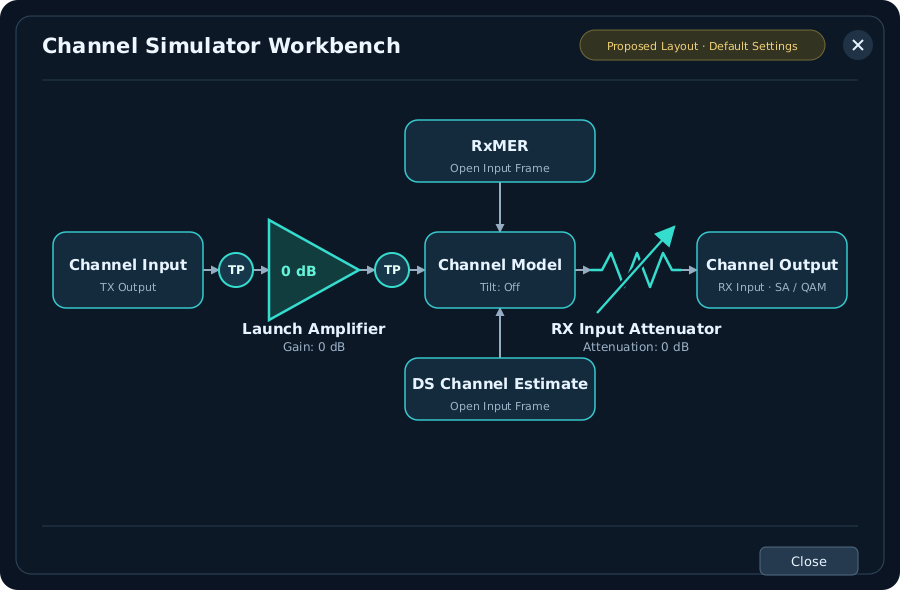

# Channel Estimate and RxMER inputs

The **DS Channel Est.** and **RxMER** blocks open separate dialogs built around
one shared measurement viewer. A capture tree on the left retains original
file metadata; the chart on the right supports zoom, full span and hover
readouts. All parsing, calculations and chart reduction happen in Rust.

Scroll over the plot to zoom around the pointer, or left-drag horizontally to
select a range. **Full Span** resets the view. There are no +/- zoom buttons.
Click the plot for keyboard +/- zoom and Home reset. Changing a capture or metric
resets the range; zoom only queries retained input data.

Apply a DPD first. Inputs must match its device, channel, frequency origin,
subcarrier spacing and complete source grid. Merely overlapping frequencies do
not qualify. Active carrier coverage is checked before Apply. Missing/excluded
values remain distinguishable; no frequency resampling or replacement is hidden.
A configurable capture association tolerance defaults to 90000 seconds as an
application policy, not a specification requirement. Original timestamps stay
unchanged.

## Channel response

The default is **Flat / unity H = 1 + 0i**, equivalent to **0 dB gain / 0° phase**
per subcarrier. This synthetic configuration needs no file and becomes ready
once the DPD/OCD grid is valid. It is not a measured capture or receiver estimate.
A linear response of 0 + 0i would suppress the signal.

Use **Open file…** for binary channel-estimate PNM or supported decoded JSON,
or **Load demo** for the bundled decoded example. Select gain, wrapped phase,
real H or imaginary H in the shared viewer. Zero/missing active gains and
incompatible grids reject Apply. **Flat / unity** returns the draft to the
synthetic default; Cancel preserves the accepted configuration.

## RxMER captures

Use the OS-native **Open file(s)…** chooser for one or multiple binary RxMER PNM
or decoded JSON files. Detection uses contents rather than extensions. The pinned
PNM Viewer Rust library handles binary decoding; MERLIN owns simulation policy.
Expand a tree row for identity, frequency, capture time, format and original hash.
Select a row to inspect its original values, or **Effective RxMER / playback**
to inspect the proposed combination. Duplicate byte-identical files reject.

| Mode | Effective model |
| --- | --- |
| Single capture | One per-carrier observation held for the run. Requires one file. |
| Average | Equal-capture-weight mean of linear residual error power, held for the run. |
| Sequence · hold | Hold each capture until the next explicit symbol boundary. |
| Sequence · interpolate power | Linearly interpolate error power between adjacent captures at the selected symbol. |

The simulation uses normalized error power `v = 10^(-RxMER/10)`. Average and
interpolation operate on v; the chart converts back with `-10 log10(v)`. They
never average/interpolate frequency grids or silently discard missing required
values. This differs from the viewer's arithmetic-dB display statistic.

For a sequence, enter **OFDM symbols between captures**. At 25 kHz spacing and
CP512, 1000 symbols corresponds to 42.5 ms. **Preview symbol** selects the point
in the synthetic schedule to display. Move selected files earlier/later or
explicitly **Sort by capture time**; filenames never determine playback order.
The final capture is held after the last transition, with no extrapolation or
implicit looping. Recorded capture times are separate from this playback clock.

RxMER uses **Open file(s)…** for capture selection; Load demo and Add notch demo
have been removed from its toolbar. The Channel Estimate editor retains its own
Load demo action. Adding a second file requires selecting Average or
one of the sequence modes. The combined chart always identifies the effective
residual model, not a new measured capture. RxMER does not establish real burst
correlation or reconstruct measured I/Q.

## Readiness and current scope

Apply validates the entire draft before replacing accepted state. Invalid edits
and Cancel preserve accepted inputs. Replacing DPD or OCD revalidates dependent
configuration; old incompatible inputs report an error instead of silently being
realigned. Channel Simulator is green when both accepted RxMER and channel
response and additional-loss configurations are valid. Opening Channel Model shows their summary
and links back to the editors.

Green means **configured**, not a running simulation. This task provides shared
viewers, accepted input state and reusable Rust combination/preview operations.
Main Start dispatches the frozen configuration through the closed-loop worker,
with actual payload/PLC QAM and channel-output SA observations. The TX SA's local
**Run simulation** remains a separate preview before these impairments.
Receiver Apply checks that the playback transition span fits the selected run
duration; a valid editor schedule can still be too long for that request.

The editor accepts at most 64 RxMER files, 64 MiB original RxMER bytes and four
million decoded carrier values. One response file has a separate 16 MiB ceiling;
each input file is at most 16 MiB. Originals/full arrays remain in Rust; each chart
returns at most 1024 min/max groups, preserving narrow extrema and missing-data
breaks. Workbench JSON Save/Open preserves accepted original files and settings; see the
[run/save guide](closed-loop-workbench.md).

See the [design and validation](../development/features/rxmer-workbench/design.md),
[existing engine playback](impairments/measurement-timeline.md) and
[paired receiver constellation](impairments/paired-constellation.md).

## Channel Simulator stages

Click **Channel Simulator** to open **Channel Input → Channel Model → Channel
Output**, with separate **RxMER** and **DS Channel Estimate** input blocks.
Click either measurement block to open its existing input frame.

Click **Channel Input** or **Channel Output** to choose **Spectrum** or **QAM**.
Input Spectrum uses TX output samples; input QAM shows the retained physical TX
FFT symbol with bin-range filters. It does not identify Data/NCP roles from point
positions. Output Spectrum uses channel-output samples at RX input; output QAM
uses actual received FFT cells **before equalization**, with the existing received
role/profile/bin/symbol selectors. Empty selections stay unavailable.

There is no separate SA block. Opening an instrument does not run the simulation;
use the main workbench Start/Stop/Pause controls. After changing accepted settings,
run again to populate current observations.

Channel Model shows input summaries and opens the separate
[Additional Tilt / Cable Loss editor](impairments/additional-loss.md). The default
is Off. Manual tilt or full additional cable loss composes with the supplied
response, preserving the imported files. These settings save in the WB JSON.

See the [staging design](../development/features/channel-workbench/design.md)
and [additional-loss design](../development/features/channel-tilt/design.md).

## Planned launch amplifier, attenuator and TapPoints

The proposed power-budget layout keeps both conditioning controls inside Channel
Simulator. Click the amplifier triangle or variable-attenuator symbol itself to
open settings; there are no separate Configure buttons or blocks. Planned defaults
are **0 dB gain**, **0 dB attenuation** and **Tilt Off**, requiring no initial setup.
Zero dB means unchanged level, not0 dBmV absolute power. Receiver AGC is separate.

Circular **TP** (TapPoint) controls sit before and after the amplifier. Clicking a
TP opens an **SA / QAM** chooser for that point. Both routes reuse shared
instrument windows, with the selected tap named in the title. There is no
standalone SA block or junction branch. Output instruments remain at receiver
input after attenuation. The compact layout uses equal gaps between neighboring
icons, centered captions, straight connectors and matching upper/lower input
blocks at equal distances from Channel Model.

The planned SA calculates total **Channel Power** at its selected tap in dBmV,
separately from the6 MHz equivalent level. Its integration bandwidth is explicit
and independent of display zoom. These controls and absolute RF-power checks are
**not implemented**; see the [power-budget plan](../development/features/rf-power-budget/design.md).
