# Configurable-duration reference channel

The channel session connects the completed transmitter and receiver stages into
one continuous downstream OFDM experiment. Select a duration before construction;
the initial default is one simulated second. Calls advance one complete OFDM
symbol at a time, keeping all scientific state between calls. Simulated duration
is independent of how long the host takes to calculate it.

```mermaid
flowchart LR
    CONFIG["Frozen channel layout and duration"] --> PLAN["Integer sample-clock plan"]
    PLAN --> ACQ["Actual PLC acquisition through waveform samples"]
    ACQ --> TX["PRBS15 / finite file → BCH/LDPC → payload/NCP TX"]
    TX --> WAVE["Physical pilots/PLC → IFFT/prefix/window → unity channel"]
    WAVE --> RX["Framing/FFT → received configuration → payload RX"]
    RX --> COMPARE["Independent post-decode source comparison"]
    COMPARE --> RESULTS["Bounded step output and cumulative totals"]
```



| Component | Design |
| --- | --- |
| Duration and source-symbol schedule | [Timing](timing.md) |
| Session state and encapsulated TX/RX composition | [Session](session.md) |
| Per-step outcomes and interval accounting | [Results](results.md), [window accounting](accounting.md) |
| Cancellation, budgets and partial jobs | [Job lifecycle](job.md) |
| Standalone command and shared JSON | [CLI](cli.md) |

The current path is uniform256-QAM ProfileA, short rate8/9 payload FEC, one
fixed channel and a noiseless unity connection by default. Optional
[waveform impairments](../impairments/README.md) add sample AWGN or selected RxMER
residuals plus supplied channel response. NCP uses the selected supported
positive QPSK/16-QAM/64-QAM control constellation. PRBS15 is experiment traffic,
not a substitute for PHY scrambling. Actual PLC packets configure independent
payload reception; original payload bits and TX queue IDs are never RX inputs.
Known-reference timing/layout bootstrap is still explicit.

Run the example in release mode because actual time-sample processing is costly:

```bash
./scripts/cargo-local.sh run -p docsis-ofdm-fec --release --example channel_run --locked
```

The example uses a synthetic24MHz50kHz layout with maximum interleaver depth.
The optional argument selects milliseconds, for example1010ms to cross a
one-second boundary, or3ms for a quick demonstration:

```bash
./scripts/cargo-local.sh run -p docsis-ofdm-fec --release --example channel_run --locked -- 3
```

The example prints the stepping API's Rust JSON summary. The shared
[channel job and CLI](cli.md) now add cooperative cancellation, host-runtime
limits, finite detailed-result retention, explicit partial status and bounded
stage export. [Window accounting](accounting.md) separates contained words from
boundary-crossing/outside words before calculating information-bit rate.

See [architecture](../../architecture.md) and [checklist](../../development/checklist.md).

Finite [text/binary file traffic](../simulation/file-source/README.md) shares this
channel path, with optional PRBS15 fill and separate original-file recovery.
