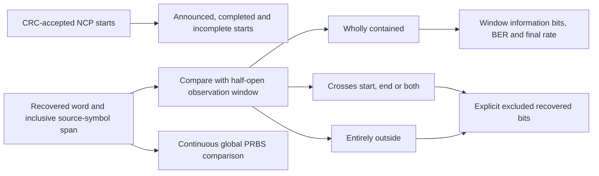

# Source-window payload accounting

The measurement window belongs to the source-symbol timeline, before delayed
receive completion. A codeword recovered during completion or interleaver drain
can still belong wholly inside observation. Arrival time alone must not exclude it.
The receiver supplies first/last source-symbol identities from actual decoded
collection; TX queue IDs and original payloads remain outside receive decisions.

For source window \([a,b)\) and a recovered word occupying inclusive source
symbols \([u,v]\), a word is contained exactly when

\[
a\le u\le v<b.
\]

Other overlapping spans are classified as crossing the start, end, or both.
Disjoint spans are outside. This is a conservative **whole-codeword** policy;
we do not apportion BCH information bits according to the fraction of coded cells
inside a boundary. A short observation can contain zero complete words even
though some coded cells were transmitted.

The first sample is \(aL\), and each word's sample span is
\([uL,(v+1)L)\), where \(L=N+N_{CP}\). These are source-symbol bounding
coordinates, not precise bit-level MAC delivery timestamps. Requested unused
trailing ticks remain in the observation-time denominator.

For contained recovered words \(\mathcal C\), compared information bits \(N\),
errors \(E\), sample budget \(S_T\), and sample clock \(F_s\):

\[
N=\sum_{w\in\mathcal C}N_w,\qquad
E=\sum_{w\in\mathcal C}E_w,\qquad
\mathrm{BER}=E/N\ (N>0),\qquad
R_{payload}=\frac{NF_s}{S_T}\ \mathrm{bit/s}.
\]

BER is null before any contained comparison. Rate is published only after a
successfully completed duration run, including required drain; partial jobs keep
it null. The result is the rate of whole contained FEC information payloads, not
RF channel capacity or application/MAC throughput. Boundary/outside words are
still compared against the independent continuous PRBS stream so exclusion never
shifts future truth alignment.

Incomplete-window counts use **received announced starts**, not guessed queued
traffic. A received nonzero/non-NULL start inside the window is counted until
its word completes; a start not yet received cannot be inferred here. Partial-job
results separately report generated-but-unrecovered payloads, which also include
queued or in-flight words whose starts have not yet reached RX.

[Window tests](../../../crates/ofdm/tests/run_infrastructure.rs) cover exact edges,
all five placements, reversed spans and overflow. [Job tests](../../../crates/ofdm/tests/channel_job.rs)
check contained/crossing/outside totals, delayed contained words, rate arithmetic,
received incomplete starts and cancellation. See [timing](timing.md) and
[job lifecycle](job.md).
