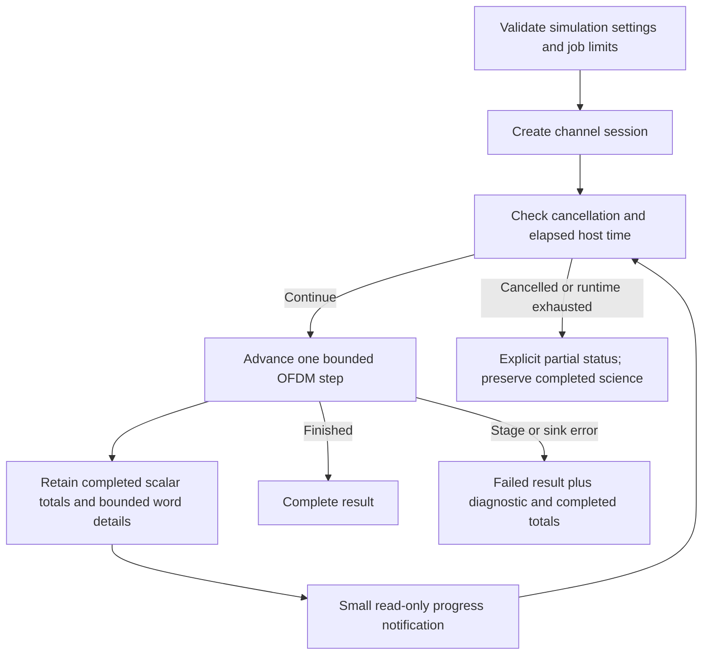

# Channel job lifecycle

The job wrapper owns host-runtime limits, cooperative cancellation, progress and
bounded retention. The underlying session still owns simulation sequencing and
independent TX/RX state. Simulated observation duration does not set host execution
speed or the wall-clock budget.

## Workbench run stages

After Start, each selected run profile passes through the following stages.

| Stage | What it does |
| --- | --- |
| Preparing | Validates settings and creates the transmitter, channel and receiver. |
| Acquiring | Transmits PLC signaling and establishes received configuration before payload processing. |
| Observing | Runs the configured measurement period: transmits symbols, applies channel impairments and decodes the received signal. |
| Completing | Finishes transmitting already queued payload codewords while the receiver continues decoding; no new source payloads are generated. |
| Draining | Flushes delayed symbols from the transmit interleaver through the channel and receiver so pending decoding can finish. |
| Finishing | Finalizes and collects transmitter/receiver results for display. |
| Run complete | Processing has ended; results are available to inspect. |

The sequence repeats for each selected profile. **Duration per Profile** sets
the simulated **Observing** interval, not elapsed wall-clock time. Acquisition,
completion and drain add processing outside that interval. A deeper interleaver
requires more drain steps; the time taken also depends on decoding work and host
performance. See [session sequencing](session.md) for the underlying state machine.

Preparing and Finishing are workbench progress labels around the core phases;
Run complete is the final job status. Cancellation, a runtime limit or an error
can end a run before normal completion, as described below.

Statuses are `complete`, `cancelled`, `runtime_exceeded` and `failed`. These are
independent of BER and FEC success flags. Cancellation/runtime exhaustion does
not fabricate comparisons for incomplete words and does not force an extra drain.
It preserves completed scalar science, finite word details and current pending
received bits/window counts. A partial prefix may legitimately have no compared
bits and null BER/rate.

The token is checked before every symbol and final-tail operation, including
acquisition/completion/drain. A step, constructor, observer or progress callback
cannot be interrupted internally, so the host budget can be exceeded by that
bounded operation and callback latency. Caller callback costs count toward the
next budget check. The default host budget is300000ms; requested observation time
remains separately configurable with a one-second default.

Detailed words are retained up to an explicit count, default64 and maximum10000.
Zero retention is supported. Simulation totals continue after detail retention is
exhausted. `omitted_word_details` counts details not retained, including recovery
completed before a failed observer prevented a successful step return.
`unrecovered_generated_payloads` counts generated/admitted words without recovered
comparisons. It is not the same as received pending coded bits or announced starts.

Observer failures return a Failed result with the diagnostic and already-completed
summary comparisons. This preserves science without pretending a failed export
was successful. There is no implicit restart or retry of a failed session.
The CLI writes that failed result before returning a nonzero exit status.
Cancellation/runtime partial results are valid outputs and return CLI success;
consumers must inspect `status`.

A deterministic-clock unit test checks runtime exhaustion without flaky sleeps.
Integration tests cancel after real recovery, cancel before work, reject invalid
limits, preserve results after sink failure and bound retained details. Separate
[CLI tests](../../../crates/cli/tests/channel.rs) exercise actual file behavior.
