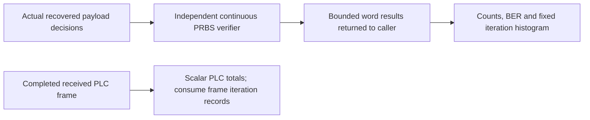

# Channel step results and interval accounting

Each step returns completed word comparisons, genuine LDPC iterations/BCH outcomes,
and source/channel symbol identities. The session retains scalar totals and a
fixed iteration histogram. This allows a consumer to inspect every word without
forcing the library to retain the entire run history.

| Interval/result | Meaning |
| --- | --- |
| Acquisition symbols | PLC configuration acquisition before the payload origin; no source payload is offered here. |
| Observation symbols | Exactly the complete source symbols in the duration plan; excludes unused trailing ticks. |
| Completion symbols | Extra source periods needed to place already-generated queued words; no new payloads are supplied. |
| Interleaver drain | M−1 delayed channel periods after all queued words are placed. |
| RX warm-up | The first M−1 payload channel periods with no restored source symbol; overlaps the source observation/completion timeline and is not an extra additive interval. |
| Waveform tail | Remaining overlap/window samples; does not fabricate another complete period. |
| Compared bits | Only actually recovered payload bits compared against the independent expected PRBS stream. |
| Codeword errors | Words with payload mismatches or a failed LDPC/BCH outcome; these conditions remain visible separately per step. |
| Payload iteration histogram |101 bins indexed by actual iteration count0..100; sum equals recovered word count. |
| PLC/NCP iterations | Scalar sum of actual control decoder iteration counts, distinct from payload iterations. |

For cadence \(L\), additive interval symbol counts \(A,O,C,D\), and final
tail length \(W\), the physical sample count is

\[
S_{physical}=(A+O+C+D)L+W.
\]

RX warm-up is excluded from this sum because it already overlaps those intervals.
Payload BER is null until at least one recovered bit has been compared. After
that it is \(E/N\), using actual payload bit errors and tested bits. A zero
error count before any comparisons is not a measured zero BER.

A Finished session requires all generated payloads recovered, zero pending
payload bits and agreement between generated and compared source-bit counts.
This is a completion check, not a requirement that a noisy receiver always
correct all errors. Optional waveform impairments now exercise real noisy decoding.
Decoder flags remain distinct
from truth error counts.

`measured_mer_db` is an observation-phase post-equalization data-bin diagnostic
against independent transmitted symbols, not the normative pilot-based RxMER
measurement or hidden receiver input. Actual LDPC/BCH failure counts, mean LDPC
iterations and its histogram accompany BER and BCH-corrected-bit counts. See
[impaired experiments](../impairments/experiments.md) for interpretation and controls.

The global totals include words completed after observation. They must not be
divided by the observation duration as extra capacity. The separate `window`
section now applies [whole-codeword source-window accounting](accounting.md),
retaining crossing/outside counts and computing rate only for a completed job.
Partial jobs retain unavailable final rates and expose incomplete received starts
separately from generated-but-unrecovered payloads.

The [job wrapper](job.md) supplies explicit completion/cancellation/runtime/failure
status and finite retained word details. The [CLI](cli.md) writes those same typed
results. Completed comparisons remain readable after failure, but the Failed phase
cannot be presented as successful duration completion.

See [timing](timing.md), [session](session.md) and [PRBS comparison](../simulation/prbs.md).
