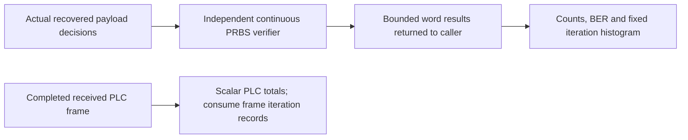

# Channel step results and interval accounting

Each step returns completed word comparisons, genuine LDPC iterations/BCH outcomes,
and source/channel symbol identities. The session retains scalar totals and a
fixed iteration histogram. This allows a consumer to inspect every word without
forcing the library to retain the entire run history.

| Interval/result | Meaning |
| --- | --- |
| Acquisition symbols | PLC configuration acquisition before the payload origin; no source payload is offered here. |
| Observation symbols | Exactly the complete source symbols in the duration plan; excludes unused trailing ticks. |
| Completion symbols | Extra source periods needed to place already-generated queued words; no new payloads are supplied. |
| Interleaver drain | M−1 delayed channel periods after all queued words are placed. |
| RX warm-up | The first M−1 payload channel periods with no restored source symbol; overlaps the source observation/completion timeline and is not an extra additive interval. |
| Waveform tail | Remaining overlap/window samples; does not fabricate another complete period. |
| Compared bits | Only actually recovered payload bits compared against the independent expected PRBS stream. |
| Codeword errors | Words with payload mismatches or a failed LDPC/BCH outcome; these conditions remain visible separately per step. |
| Payload iteration histogram |101 bins indexed by actual iteration count0..100; sum equals recovered word count. |
| PLC/NCP iterations | Scalar sum of actual control decoder iteration counts, distinct from payload iterations. |

For cadence \(L\), additive interval symbol counts \(A,O,C,D\), and final
tail length \(W\), the physical sample count is

\[
S_{physical}=(A+O+C+D)L+W.
\]

RX warm-up is excluded from this sum because it already overlaps those intervals.
Payload BER is null until at least one recovered bit has been compared. After
that it is \(E/N\), using actual payload bit errors and tested bits. A zero
error count before any comparisons is not a measured zero BER.

A Finished session requires all generated payloads recovered, zero pending
payload bits and agreement between generated and compared source-bit counts.
This is a completion check, not a requirement that a noisy receiver always
correct all errors. Current operation is noiseless. Decoder flags remain distinct
from truth error counts.

These totals include words completed after observation. They must not be divided
by the observation duration and advertised as observation-window throughput:
precise complete/incomplete/excluded payload classification is RUN-04, and is
still pending. Likewise the stepping summary is not yet a formal cancellation
result or CLI job document. Completed comparisons remain readable after a failure,
but the Failed phase cannot be presented as a successfully completed run.

See [timing](timing.md), [session](session.md) and [PRBS comparison](../simulation/prbs.md).
