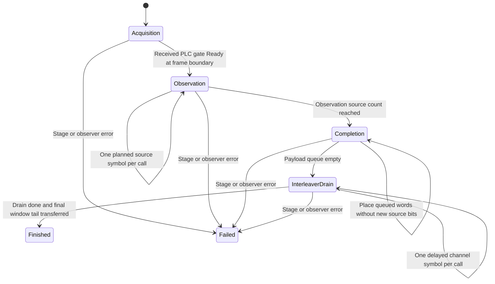

# Continuous channel session

The runner owns sequencing and lifecycle. Existing payload and waveform modules
continue to own TX and RX algorithms. There are no replacement FFT, mapper,
randomizer, interleaver or FEC implementations in the runner.

Construction validates and copies the settings. Changing the caller's original
settings does not reconfigure a running session. Source and verifier each own a
PRBS15 stream initialized once. Observations must use exclusive sequential access
to the session; no second-boundary clock or host timer drives simulation state.

Acquisition advances real PLC, pilot and waveform processing one symbol at a
time. The received gate admits actual OCD/ProfileA/NCP descriptors; at the next
128-symbol-aligned boundary, the runner creates independent payload TX/RX owners.
Acquisition is limited to eight PLC frames. Known bootstrap timing and physical
layout remain explicit; this is not blind RF acquisition.

During observation, the transmitter's queue is replenished to eight payloads
before each source symbol. The PRBS generator advances only when a new14232-bit
payload is admitted. This is an offered-load policy, not an inferred channel
capacity or a guaranteed payload bit rate. The existing packer selects cells,
continuations, NCP reservations and filler. Inverse reception uses received
control pointers, not the queue's diagnostic identifiers.

When the planned source-symbol count is reached, no more payloads are generated.
Already queued words are placed during a separately counted completion interval,
bounded to4096 additional source symbols. Then the TX drains exactly M−1
matched-pair interleaver steps without fabricating new source/NCP payloads. The
final waveform tail is transferred separately. PRBS, PLC phase, randomizer masks,
partial codewords, overlap buffers and sample identities persist throughout.

The shared `simulation/channel/link.rs` composes actual waveform TX/channel/RX,
PLC scheduling and PLC reception. Both this runner and the older bounded payload
verifier use it. The runner consumes each completed PLC frame's iteration records
immediately into scalar totals, so those records do not grow with duration.
The older bounded verifier keeps its original detailed bounded result contract.

A call returns at most one physical symbol's completed outcomes, or the final
window-tail operation. Per-step results and existing bounded stage observers are
the inspection boundaries. The runner retains no complete waveform, original
payload history, or duration-sized decoded-word list. Its cumulative payload
iteration histogram has101 fixed bins; callers choose whether to retain returned
word results. The static layout, finite queues, one PLC frame and stage buffers
are bounded independently of observation duration.

Stage/control/observer errors close the session and return a typed diagnostic.
Completed summary comparisons remain available. Calling a failed session rejects;
calling a finished session returns no further steps. Failed calls are not atomic
simulation transactions and cannot be retried in place. The separate [job wrapper](job.md) now adds cancellation, wall-clock budgets,
progress and partial status. Failed-session restart remains explicit; the wrapper
retains completed totals rather than retrying a partially mutated operation.

Tests cover both spacings, maximum depth, sample chunk independence, setting
snapshot ownership, invalid limits, observer failure and finite completion/drain.
See [results](results.md) for what their counters mean.
