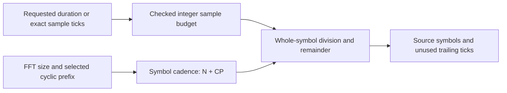

# Observation timing

The timing module converts a caller-selected duration into complete source OFDM
symbol periods. It does not generate or buffer the waveform. The channel session
uses that plan without resetting any stage at second or codeword boundaries.
The original one-second helper delegates to the same arithmetic and preserves
its existing32-bit result contract; the new schedule uses64-bit counts.

For a requested duration \(T\), sample clock \(F_s=204800000\), FFT size
\(N\), prefix length \(N_{CP}\), and overlap length \(N_{RP}\):

\[
S_T=\lfloor F_sT\rfloor,\qquad
L=N+N_{CP},\qquad
K=\left\lfloor\frac{S_T}{L}\right\rfloor,\qquad
R=S_T-KL.
\]

The duration conversion uses integer nanoseconds, checked128-bit intermediate
multiplication and checked conversion to a64-bit sample budget. The public
sample-budget operation avoids fractional time entirely. Less than one complete
symbol is rejected. Fractional sample ticks are floored, not rounded upward.
The timing primitive rejects unrepresentable counts; the actual channel-session
policy additionally bounds observation duration to one hour. This is an application
work limit, not a PHY duration restriction.

Windowed symbol length is \(L+N_{RP}\), but adjacent windows overlap by
\(N_{RP}\), so roll-off does not extend the cadence. For the25kHz baseline,
\(N=8192\), \(N_{CP}=512\), one second gives23529 whole source symbols and
3584 unused ticks. For50kHz with the same prefix, one second gives44444 whole
source symbols and2048 unused ticks.

The requested budget and its unused ticks are reported. Only complete source
symbol periods are scheduled; unused trailing ticks do not create a partial OFDM
symbol and are not included in the physically transmitted sample count.
Acquisition and completion/drain add separate whole periods and the final window
tail. Therefore total generated samples can exceed the requested source-observation
budget without extending or silently changing that budget.

Normative foundation is the existing pinned CM-SP-PHYv3.1-I20-230419 §7.5.7.1
(sample clock and FFT sizes; PDF134), §7.5.8.1 and its delegated cyclic-extension
procedure. This stage checks the local text; the existing
[waveform evidence](../../reference/waveform-evidence.md) owns the previously
verified window details. The duration limit and interval policy are simulator
design choices, not new DOCSIS requirements.

Tests independently calculate both FFT schedules for every permitted prefix,
long durations, exact symbol boundaries, fractional ticks, invalid settings and
overflow. See [session lifecycle](session.md) for how the schedule is consumed.
