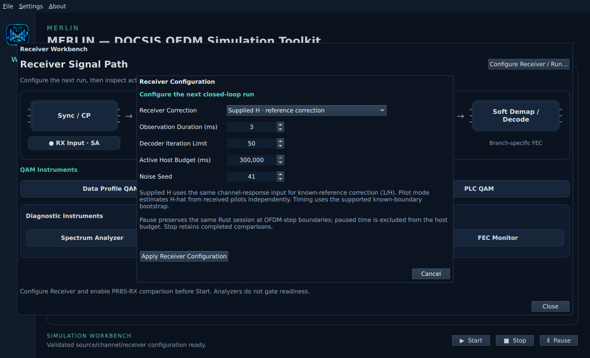
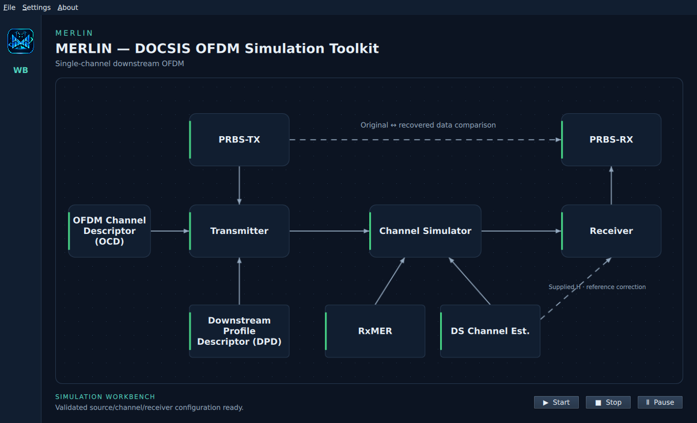
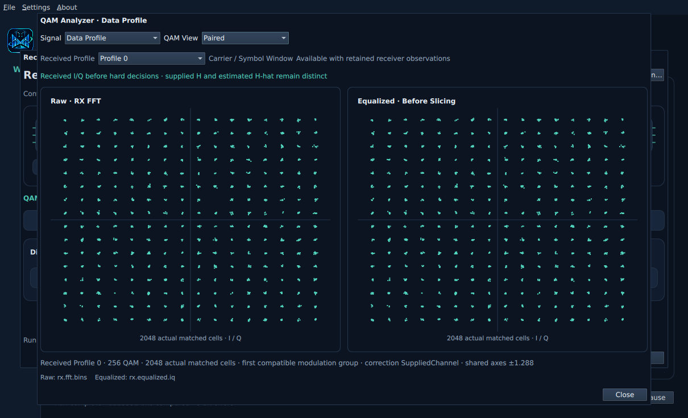
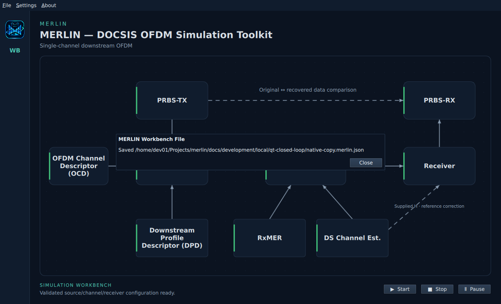

# Run and save a workbench

MERLIN's main Start button now runs the accepted source → transmitter → channel
→ receiver → independent recovered-data comparison through the existing Rust
engine. Instrument selections do not determine readiness.

## Configure and run

1. Apply an OCD-compatible **DPD Profile 0**. The current live transport supports
   Profile A ID 0; importing other profiles does not make them runnable. Load demo
   prefers Profile 0 when available. Apply PRBS-TX or an exact-byte file source.
2. Apply compatible RxMER input(s). Channel Estimate defaults to **flat H=1+0i**;
   optionally apply a real response file. RxMER is now left of Channel Estimate.
3. Open **Receiver → Configure Receiver / Run…**. Choose supplied-H reference
   correction or pilot-estimated H-hat, observation duration and finite decoder/
   host limits. Apply validates the entire accepted request and makes Receiver green.
4. Open **PRBS-RX → Enable Comparison**. It uses the independent original PRBS/file
   source. When all nine blocks are green and the worker is idle, Start is enabled.
5. Close dialogs and click **Start**. Progress appears below the diagram. **Stop**
   retains completed comparisons; **Pause / Resume** preserves the same engine at
   completed OFDM-step boundaries and excludes paused time from the host budget.

The initial UI duration is 3 ms, with 1–1000 ms allowed. This is source observation
time: acquisition/completion/drain add work. A sequence's final transition must
fit within this interval. For example, 1000 symbols at 25 kHz/CP512 need more than
42.5 ms, so a 3 ms run correctly rejects that schedule. Timing uses the supported
known-boundary bootstrap; this UI does not claim arbitrary RF acquisition.

## Inspect actual results

PRBS-RX shows complete/cancelled/runtime-exceeded/failed status, compared bits,
bit errors, BER and unrecovered generated payloads. No compared bits means BER is
unavailable, not zero. Receiver → FEC Monitor shows actual decoder totals.

Receiver's QAM analyzer now displays retained payload or PLC raw/equalized pairs.
Paired panels share axes; PLC preamble and data remain separate. Payload plots use
Profile 0 and the first compatible modulation group, up to 2048 actual points.
General carrier/time/profile selection and matched NCP I/Q collection remain
pending; NCP LLRs/messages are never fabricated into a constellation.

The RX SA has actual channel-output/framed time samples, one contiguous useful
symbol and raw FFT-bin power. Useful symbols are not concatenated across prefix
gaps. Time spectra use the shared Rust Hann PSD; FFT-bin power has different units
and uses its physical frequency grid. Changing a selector never starts a new run.

Accepted input/settings changes invalidate old observations and cancel stale work.
Receiver configuration can be green before any results exist. Expected noisy FEC
outcomes remain scientific results, distinct from invalid setup or job failure.

## Save and reopen

Use the standard **File → Save** (`Ctrl+S`) or **Save As…** (`Ctrl+Shift+S`). The
first Save asks for a native OS destination; later Save replaces that project
atomically. Save As selects a new destination. Use a `*.merlin.json` filename;
a missing suffix is appended for a new destination. Existing-file replacement
uses the native chooser's confirmation. Imported original paths are protected.

The version-1 JSON stores:

- Accepted OCD, DPD/profile selection, PRBS/file/fill source, RxMER mode/order/
  symbol intervals, channel response/default and association tolerances.
- Receiver/run settings, independent comparison acceptance and global theme.
- Exact original payload and PNM/decoded-JSON bytes as base64, with byte counts
  and SHA-256. Source paths are not needed to reopen the workbench.

**File → Open…** (`Ctrl+O`) validates the complete file before replacing accepted
state, then reloads all editors. It never starts a run automatically. Cancel or
malformed data preserves the current project. Cross-input incompatibilities are
restored as editable readiness diagnostics. Open/Save are disabled while a worker
is active; Stop and wait for completion before changing projects.

Draft edits, previous run results and transient instrument selections are not
saved. The project limit is 144 MiB, with original per-file/combined measurement
limits also enforced. Atomic sibling-file replacement preserves the previous
project if serialization/write fails. No application settings or source files are
written by simply opening a measurement or running the simulation.

See the [receiver guide](receiver-workbench.md) and [development design](../development/features/qt-closed-loop/design.md).
