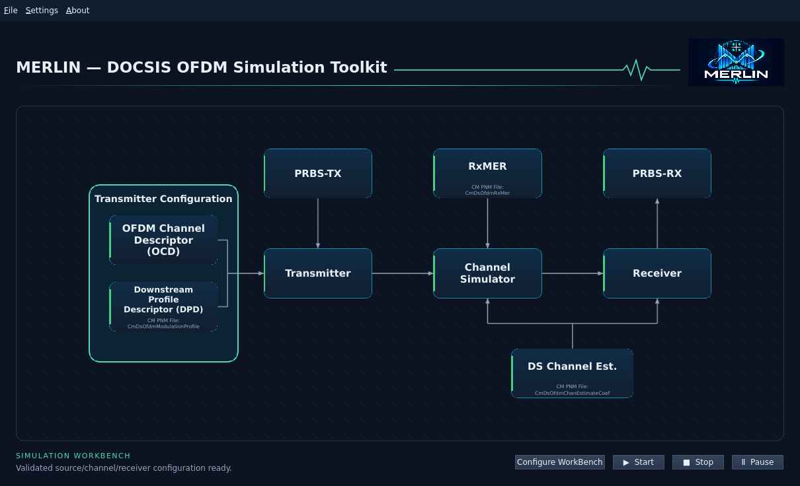
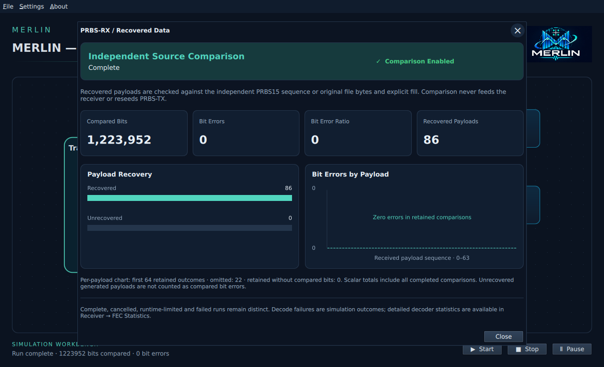
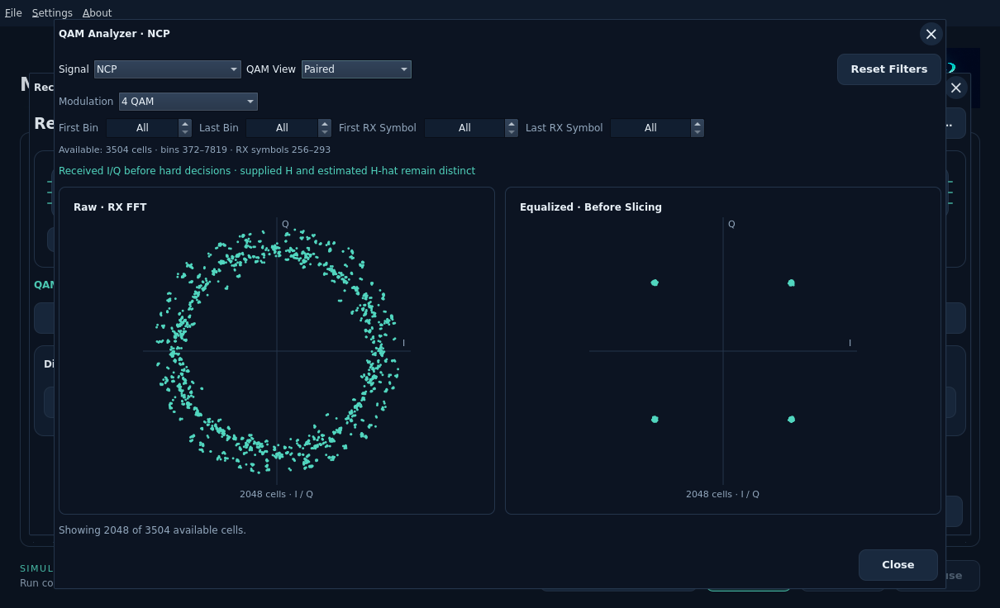
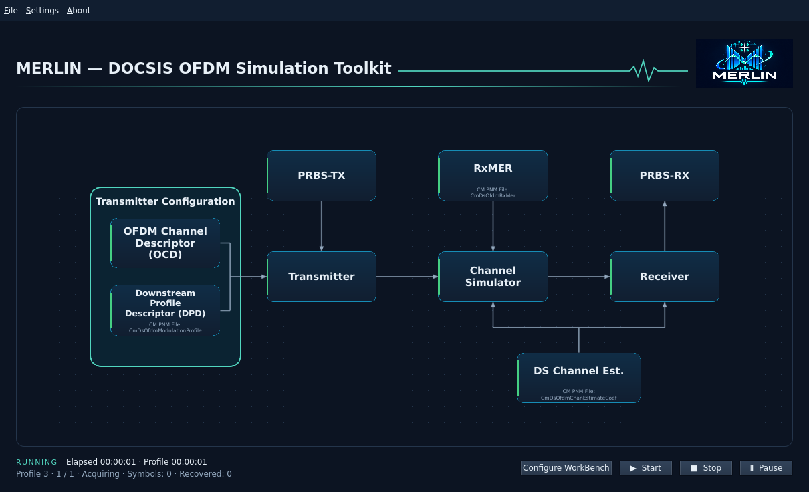
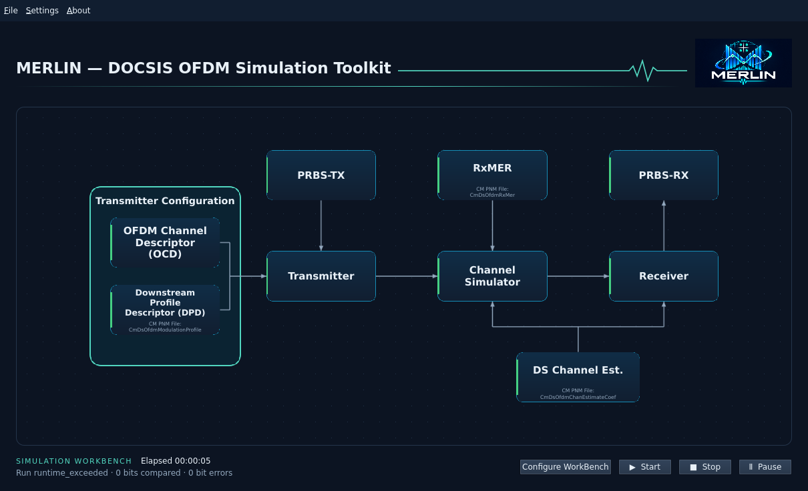

# Run and save a workbench

MERLIN's main Start button now runs the accepted source → transmitter → channel
→ receiver → independent recovered-data comparison through the existing Rust
engine. Instrument selections do not determine readiness.

## Configure and run

1. Use **File → New** or **Open**. Apply an OCD-compatible DPD and PRBS-TX
   or an exact-byte file source. Each selected captured profile runs separately
   through bootstrap wire Profile A (ID0), retaining its captured identity.
2. Apply compatible RxMER input(s). Channel Estimate defaults to **flat H=1+0i**;
   optionally apply a real response file.
3. Use main **Configure WorkBench** beside Start. Set duration per profile, total run
   budget and noise seed. In **Profiles**, check the profiles to run. New WBs
   initially select the applied profile; at least one is required for Start.
4. Use **Receiver → Configure Receiver…** for correction mode and decoder
   iteration limit. WB/Receiver options can be accepted before all inputs are
   present; readiness becomes green only after full request validation.
5. Open **PRBS-RX → Enable Comparison**. When all blocks are green, the WB is
   active and the worker is idle, Start is enabled. **Stop** retains completed
   comparisons; **Pause / Resume** preserves the current session and excludes
   paused time from the shared host budget.

The initial UI duration is 3 ms, with 1–1000 ms allowed. This is source observation
time: acquisition/completion/drain add work. A sequence's final transition must
fit within this interval. For example, 1000 symbols at 25 kHz/CP512 need more than
42.5 ms, so a 3 ms run correctly rejects that schedule. Timing uses the supported
known-boundary bootstrap; this UI does not claim arbitrary RF acquisition.

## Inspect actual results

PRBS-RX shows complete/cancelled/runtime-exceeded/failed status, compared bits,
bit errors, BER and unrecovered generated payloads. No compared bits means BER is
unavailable, not zero. Receiver → FEC Monitor shows actual decoder totals.

The PRBS-RX panel groups compared bits, bit errors, BER and recovered payloads
into summary cards. The acceptance badge replaces the disabled comparison button;
**Enable Comparison** remains available when configuration needs acceptance.
Run status distinguishes Complete, Cancelled, Runtime Limit and Failed results.
Running/paused jobs show no final totals. Closing the panel does not stop a run.

**Payload Recovery** compares recovered and unrecovered generated payload counts.
**Bit Errors by Payload** plots actual errors for compared outcomes among the
first 64 retained payloads, labeled by received sequence. Zero-error comparisons
appear on the baseline; payloads with no compared bits are excluded explicitly.
The detail note reports omitted and uncompared retained records; summary totals
cover all completed comparisons. Neither chart is a BER-over-time history.
The note is hidden when no records are omitted or uncompared. A separate BER
message appears only when no compared bits are available.

Receiver's QAM analyzer now displays retained payload or PLC raw/equalized pairs.
Paired panels share axes; PLC preamble and data remain separate. Payload plots use
Profile 0 and the first compatible modulation group, up to 2048 actual points.
NCP matched I/Q and available profile/modulation/bin/receive-symbol selectors
are implemented. Inspect response/echo, actual slicer/LLR and detailed FEC views
through the [receiver instruments](receiver-workbench.md). NCP LLRs/messages
are never fabricated into a constellation.

The RX SA has actual channel-output/framed time samples, one contiguous useful
symbol and raw FFT-bin power. Useful symbols are not concatenated across prefix
gaps. Time spectra use the shared Rust Hann PSD; FFT-bin power has different units
and uses its physical frequency grid. Changing a selector never starts a new run.

Accepted input/settings changes invalidate old observations and cancel stale work.
Receiver configuration can be green before any results exist. Expected noisy FEC
outcomes remain simulation results, distinct from invalid setup or job failure.

## Save and reopen

Use the standard **File → Save** (`Ctrl+S`) or **Save As** (`Ctrl+Shift+S`). The
first Save asks for a native OS destination; later Save replaces that project
atomically. Save As selects a new destination. Use a `*.merlin.json` filename;
a missing suffix is appended for a new destination. Existing-file replacement
uses the native chooser's confirmation. Imported original paths are protected.

The version-1 JSON stores:

- Accepted OCD, DPD/profile selection, PRBS/file/fill source, RxMER mode/order/
  symbol intervals, channel response/default and association tolerances.
- Receiver/run settings, independent comparison acceptance and global theme.
- Exact original payload and PNM/decoded-JSON bytes as base64, with byte counts
  and SHA-256. Source paths are not needed to reopen the workbench.

**File → Open** (`Ctrl+O`) uses a native file filter showing only
`*.merlin.json` workbenches, while directories remain navigable. Choose
`workbench.merlin.json` inside an example bundle; raw PNM and provenance files
are hidden. The filename filter does not
replace content validation. Open validates the complete file before replacing
accepted state, then reloads all editors. It never starts a run automatically.
Cancel or malformed data preserves the current project. Cross-input incompatibilities are
restored as editable readiness diagnostics. Open/Save are disabled while a worker
is active; Stop and wait for completion before changing projects.

Draft edits, previous run results and transient instrument selections are not
saved. The project limit is 144 MiB, with original per-file/combined measurement
limits also enforced. Atomic sibling-file replacement preserves the previous
project if serialization/write fails. No application settings or source files are
written by simply opening a measurement or running the simulation.

See the [receiver guide](receiver-workbench.md) and [development design](../development/features/qt-closed-loop/design.md).

## Independent profile runs

Main **Configure WorkBench → Profiles** selects captured profiles with checkboxes.
New WBs use the applied profile initially; legacy WBs preserve their saved
all/applied behavior. Selected profiles run separately in captured-ID order.
Duration applies per profile; the active host budget covers the selection.
WB JSON stores the selected IDs. See [Profile Performance](receiver-profile-performance.md)
for counter definitions, bootstrap Profile A mapping, limits and result selection.

## Elapsed time and slow profiles

The lower-left status shows **Elapsed HH:MM:SS** while a simulation runs, and
keeps the final time after completion, Stop or failure. **Profile HH:MM:SS**
measures the current profile separately. A new Start resets both; accepting new
configuration clears the old timing. These are wall-clock times, including
pauses and CPU scheduling waits. They are separate from simulated duration and
the active run budget. Timing is transient and is not stored in WB JSON.

The progress line shows the processing phase and recovered payload count.
**[Draining](terminology.md#interleaver-drain)** can continue after the observation-symbol count stops increasing.
The receiver still has interleaved data to process. Hover this line to see time
since the last completed processing step. Updates occur between steps, so a
long decoder step can keep counts stationary while elapsed time continues.
Stop, Pause and the active runtime limit also take effect at step boundaries.

An advancing timer shows the UI is responsive; it does not prove the decoder is
making progress or identify another process as the cause. Use the phase, last
completed step, FEC iteration histogram and system process usage together.
