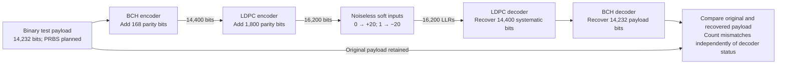

# FEC codec user guide

`fec-codec` provides the standalone Rust BCH/LDPC encoder and decoder. Use this
isolated loop to check payload recovery before adding modulation, a channel or
measurement inputs. It uses the supported downstream short-block rate-8/9 LDPC
mode with an outer BCH code.

## Run the codec loop

From the repository root, run:

```bash
./scripts/cargo-local.sh run -p fec-codec --example codec_loop --locked
```

Expected output:

```text
Payload bits: 14232 · bit errors: 0
```

The example exits successfully only when both decoders report success and the
recovered payload has zero mismatches. It generates a deterministic binary test
pattern. A defined PRBS generator is planned; neither this pattern nor the full
simulation's seeded random source is currently a PRBS implementation.

## Encode, decode and compare



BCH is the outer code: it runs first when encoding and last when decoding.
LDPC uses soft evidence to recover a codeword; BCH then corrects remaining
hard-decision errors. The diagram omits QAM and noise because this example does
not inject either. The LDPC result retains all 16,200 hard decisions; the
concatenated decoder forwards its first 14,400 bits to BCH. The BCH result
retains the full 14,400-bit word, whose first 14,232 bits are the payload.

## Use the public Rust API

```rust
use fec_codec::concatenated::{compare_payload, ConcatenatedCodec};
use fec_codec::parameters::BCH_INPUT_BITS;

fn check_payload() -> Result<(), String> {
    let payload = vec![0_u8; BCH_INPUT_BITS];
    let mut codec = ConcatenatedCodec::new()?;
    let encoded = codec.encode(&payload)?;
    let decoded = codec.decode_noiseless(&encoded.ldpc_codeword, 30)?;
    let comparison = compare_payload(&payload, &decoded)?;

    assert!(decoded.ldpc.success);
    assert!(decoded.bch.success);
    assert_eq!(comparison.bit_errors, 0);
    Ok(())
}
```

Construct a codec once and reuse it for successive blocks. Inputs use one `u8`
per bit, with values restricted to zero or one. For externally produced soft
inputs, call `decode(&llrs, max_iterations)` instead of `decode_noiseless`.
It requires exactly 16,200 finite LLRs and an iteration limit from 1 through 100.
`Result::Err` reports invalid inputs or setup failures. A valid decoding request
can return `Ok` with a decoder's `success` flag false; inspect both flags and
the payload comparison separately. See the runnable
[example](../../crates/fec-codec/examples/codec_loop.rs) and
[public API reference](../reference/public-api.md).

## Mathematics

### Block dimensions and rate

Let the binary payload be a vector over the binary field, where addition is XOR:

$$
\mathbf{b}\in\mathbb{F}_2^{14232}.
$$

Encoding produces a systematic BCH word followed by a systematic LDPC word:

$$
\mathbf{u}=\operatorname{BCHenc}(\mathbf{b})
\in\mathbb{F}_2^{14400},\qquad
\mathbf{c}=\operatorname{LDPCenc}(\mathbf{u})
\in\mathbb{F}_2^{16200}.
$$

The concatenated code carries 14,232 payload bits per 16,200 encoded bits:

$$
R=\frac{14232}{14400}\frac{14400}{16200}
=\frac{14232}{16200}\approx0.878519.
$$

This is a coding ratio, not a service throughput calculation; framing and other
PHY/MAC overhead are outside this isolated loop.

### BCH encoding and correction

Represent the payload in MSB-first polynomial order:

$$
m(x)=\sum_{i=0}^{14231}b_i x^{14231-i}.
$$

With the specified BCH generator polynomial of degree 168, append a remainder
so that the complete word is divisible by that generator:

$$
r(x)=\operatorname{rem}_{g(x)}\!\left(x^{168}m(x)\right),
\qquad U(x)=x^{168}m(x)+r(x),
\qquad U(x)\bmod g(x)=0.
$$

All polynomial coefficients are binary. The plus sign is XOR, so adding the
remainder cancels the remainder from division. The first 14,232 bits remain
the original payload; the last 168 bits are BCH parity.

The shortened BCH code corrects up to 12 bit errors. Its decoder computes
syndromes in the extension field using a primitive element $\alpha$:

$$
S_j=U_{\mathrm{received}}(\alpha^j),\qquad j=1,\ldots,24.
$$

Berlekamp–Massey determines an error-locator polynomial; a Chien search locates
bits to flip. The decoder checks the corrected syndromes before reporting
success. More than 12 errors are outside the correction guarantee and can
sometimes produce a wrong valid codeword, making the original-payload comparison
essential in a simulation.

### LDPC encoding and soft decoding

The parity-check matrix has 1,800 rows and 16,200 columns. A valid codeword
satisfies the following equation over the binary field:

$$
H\mathbf{c}^{T}=\mathbf{0},\qquad
H=[H_u\;H_p],\qquad \mathbf{c}=[\mathbf{u}\;\mathbf{p}].
$$

The encoder computes the 1,800 parity bits so that

$$
H_p\mathbf{p}^{T}=H_u\mathbf{u}^{T}.
$$

The receiver uses natural-log likelihood ratios (LLRs):

$$
L_i=\ln\frac{\Pr(c_i=0\mid y_i)}{\Pr(c_i=1\mid y_i)}.
$$

A positive LLR favors zero; a negative LLR favors one. For this noiseless
test, the encoded bit is converted directly to finite reliable evidence:

$$
L_i=20(1-2c_i)=
\begin{cases}
+20,&c_i=0,\\
-20,&c_i=1.
\end{cases}
$$

The value 20 is a test convention, not an MER, noise variance or calibrated
channel measurement. The horizontal layered sum-product decoder iteratively
updates its soft beliefs using the parity constraints. Decoding stops on
parity-check success or the iteration cap. Its first 14,400 hard decisions then
become the BCH decoder input.

### Payload recovery and error measurement

Let $\hat{\mathbf{b}}$ be the first 14,232 bits after BCH decoding. The comparison
counts actual differences from the saved source:

$$
E=\sum_{i=0}^{14231}\mathbf{1}\{b_i\ne\hat b_i\},
\qquad \mathrm{BER}_{\mathrm{payload}}=\frac{E}{14232}.
$$

Here the indicator is one for a mismatch and zero otherwise. `compare_payload`
returns the mismatch count and tested-bit count; the BER above is their ratio.
The example's expected result is $E=0$. Passing decoder parity checks establishes
codeword validity; comparing against the source establishes payload recovery.

## Evidence and current limits

The dimensions follow CM-SP-PHYv3.1-I20-230419 §7.5.4.2, Table 23 (PDF page 114),
which delegates the coding definitions to ETSI EN 302 769 V1.2.1 (2011-04).
BCH parameters and generator factors are in ETSI Tables 3(b)/4(b) (PDF pages
29–30); the short rate-8/9 LDPC addresses are in Annex B, Table B.6 (PDF page 96).
The implementation uses the pinned Rust `ldpc-toolbox` dependency and a Rust BCH
implementation. Local specification evidence remains under ignored `development/`.

This example verifies the isolated coding path. It does not establish DOCSIS
framing, waveform placement or interoperability. See
[coding scope and channel equations](../reference/coding-mode.md) for the broader
simulation, and [CLI usage](../cli.md) to run it.
