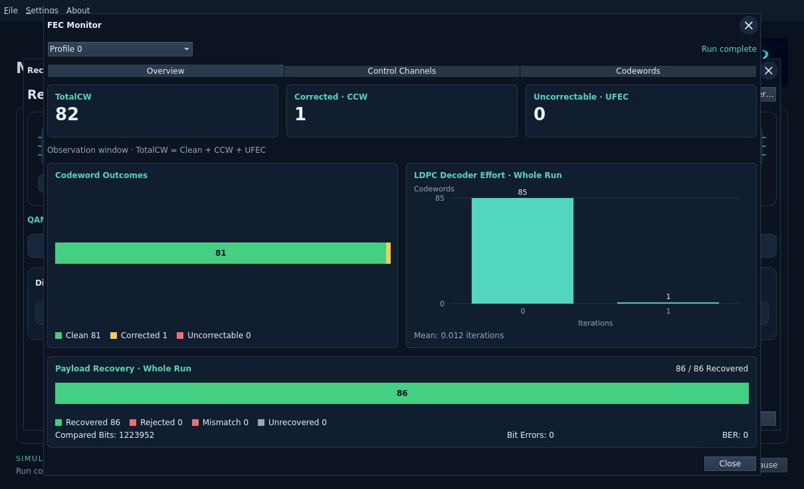
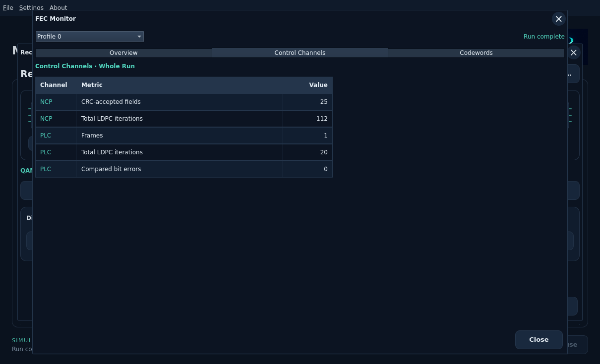
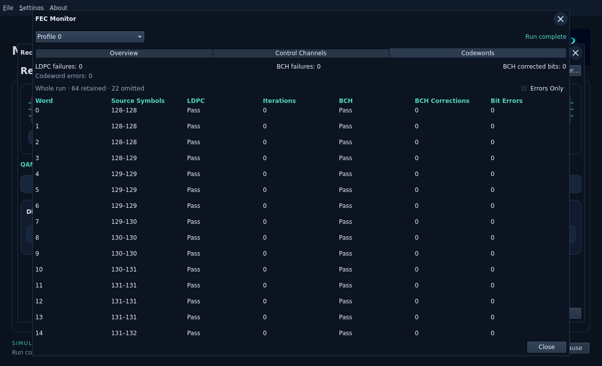

# FEC Monitor

Open **Receiver → FEC Statistics** or **FEC Monitor**. Both open this instrument.
Select a captured profile to inspect its retained complete or partial result.
Changing profiles does not run the simulation or change other instruments.

## Overview

**TotalCW**, **CCW** and **UFEC** cover codewords fully contained in the
observation window. The outcome bar separates clean, corrected and uncorrectable
codewords. TotalCW equals Clean + CCW + UFEC. CCW counts words corrected by LDPC
or BCH; BCH corrected bits alone can be zero even when CCW is positive.

**LDPC Decoder Effort** shows actual whole-run codeword counts at each iteration
count. It fits the occupied range and preserves empty bins between observations.
Hover a bar for its exact count. The mean is displayed to three decimal places.
No decoder attempts means an empty graph, not a synthetic zero-iteration word.

**Payload Recovery · Whole Run** covers generated payloads across the complete
run, including startup/drain. Recovered means decoder-accepted with no detected
source mismatch. Rejected words, independent source mismatches and unrecovered
payloads are separate segments. Compared bits, bit errors and BER describe the
independent source comparison; unavailable BER is shown as a dash. These totals
can differ from the observation counters because their counting scopes differ.
A decoder-accepted payload without compared source bits is not proof of matching
source data; inspect compared bits and BER alongside the recovery bar.

## Control Channels

A compact table keeps Channel, Metric and Value together. Each row reports one
whole-run counter for NCP or PLC; missing values appear as a dash.

The separate tab shows CRC-accepted NCP fields, total NCP LDPC iterations, PLC
frames, total PLC LDPC iterations and compared PLC bit errors. These totals do
not contribute to the payload outcome bar.

## Codewords

Aligned columns show word number, source-symbol interval, LDPC result/iterations,
BCH result/corrected bits and compared bit errors. **Errors Only** filters retained
records with decoder failures or source bit errors. It does not filter the overall
counters or graphs. At most64 completed records per profile are retained; the
omitted count remains visible. No errors in those records is not a claim about
omitted records. BCH/LDPC failure totals and codeword errors remain visible here.

Stopped, budget-exceeded and failed runs remain labeled partial. Unstarted
profiles and empty results show their status without invented counters. Up to32
bounded profile summaries are transient; accepting new inputs or starting a new
run clears them. Results are not stored in workbench JSON.
