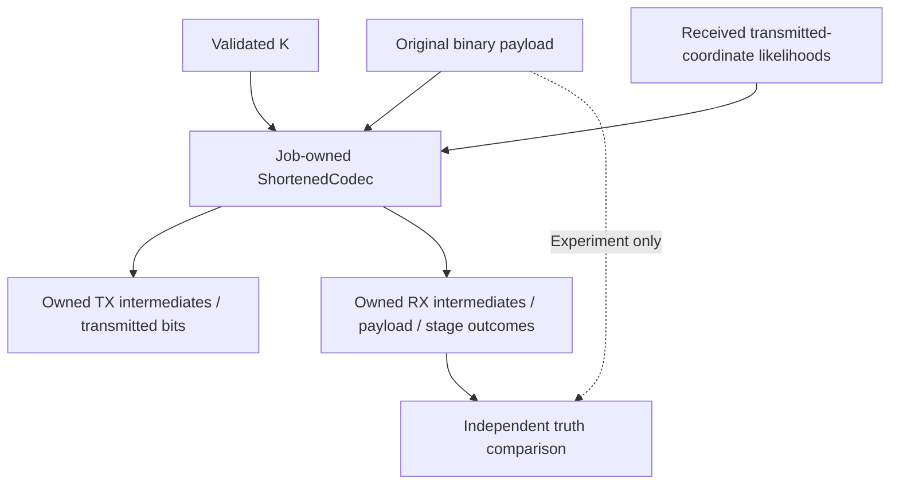

# Reusable shortened codec composition

`ShortenedCodec` owns an immutable geometry and one reusable LDPC mother encoder/
decoder. The existing BCH kernel remains shared and immutable. Construct once
per job/geometry, then encode or decode successive words sequentially. No QAM,
source RNG, file, network or presentation state enters this component.

| Direct test point | Shape and meaning |
| --- | --- |
| BCH input reconstruction |14232 bits, S leading known zeros then K original bits |
| Encoded BCH mother |14400 bits, including original BCH zero prefix and all parity |
| Padded LDPC input |14400 bits, K+168 BCH bits followed by S zeros |
| Encoded LDPC mother |16200 bits, valid mother-matrix syndrome |
| Transmitted word |K+1968 bits, before bit interleaving/QAM |
| Restored RX likelihoods |16200 finite natural-log LLRs, known-zero positions explicit |
| LDPC/BCH decisions |Full mother words, actual flags/corrections/iterations retained |
| Recovered payload |K bits only, including failed decisions for honest truth analysis |

These are ordinary returned Rust values and stage operations. They do not require
logging or a mutable observer and are not new registered channel JSONL events.
An adapter can consume them without duplicating the shortening arithmetic.

All allocations are bounded by the existing mother dimensions. Invalid shape,
nonbinary/nonfinite inputs and invalid work caps reject. A failed decoding
attempt remains an outcome, not an input error; the reusable decoder resets for
its next input as in the existing codec. Inputs are borrowed and remain unchanged.
The library uses the caller-owned standard log facade for scalar diagnostics;
it installs no logger and records no payload vectors.

Full-length encoding and noiseless recovery are tested bit-for-bit against the
existing `ConcatenatedCodec`; established constructors and constants are kept.
The new API applies its documented finite LLR saturation even when K=14232.
No other mother rate or64800-bit block is introduced.
