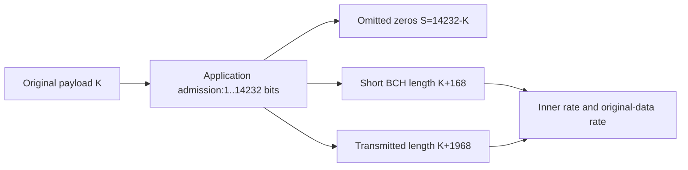

# Shortening parameters and rates

`Shortening` owns one validated original payload length K. All derived positions
come from the same object, so TX and RX can use a checked geometry rather than
scattered offsets. No separate mother matrix or BCH field is selected.

From PHY I20 Table23 and Figures46–47, PDF114–115:

$$
S=14232-K,\quad N_{\mathrm{BCH,tx}}=K+168,\quad
N_{\mathrm{tx}}=K+168+1800=K+1968.
$$

There are S omitted positions at each mother encoder, but **only S bits are
removed from the LDPC mother word's transmitted length**. BCH and LDPC shortening
occur at different intermediate boundaries; do not subtract2S from16200.

Two rates answer different questions:

$$
R_{\mathrm{original}}=\frac{K}{K+1968},\qquad
R_{\mathrm{inner}}=\frac{K+168}{K+1968}.
$$

| Original bits K | Omitted zeros S | Short BCH bits | Transmitted bits |
| ---: | ---: | ---: | ---: |
| 1 | 14231 | 169 | 1969 |
| 6136 | 8096 | 6304 | 8104 |
| 14232 | 0 | 14400 | 16200 |

The PHY I20 §7.5.4.2.3.1, PDF116 example calls6304 bits the information side of
the shortened LDPC word. Those bits include168 BCH parity: the original payload
is6136 bits. Its approximate7/9 rate is6304/8104; original-data rate is6136/8104.

The nonempty1..14232 policy is this API's admission rule, not a claim that
CableLabs requires transmitting a1-bit payload or sets that minimum. Bit-granular
codec support does not establish MAC-byte framing or shortened waveform support.
K=14232 remains the existing full-word case; zero/oversized lengths,64800-bit
normal frames and alternative mother rates are not selected by this API.
