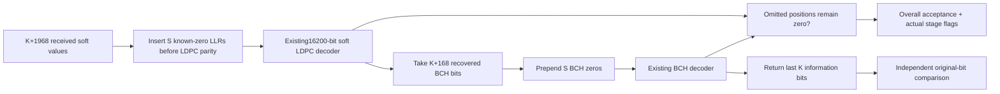

# Shortened-codeword receiver and truth comparison

The receiver accepts **transmitted-coordinate LLRs after inverse bit processing**.
Geometry K is explicit at this codec boundary; waveform length discovery/signaling
must provide it independently when QAM-03 integrates shortened transport.

Let $L$ be the K+1968 likelihood vector, $Q=K+168$ and $C=100$. The
finite implementation policy is:

$$
L_{\mathrm{mother}}=
\operatorname{clip}(L_{0:Q},-C,C)\Vert(+C)^S\Vert
\operatorname{clip}(L_{Q:Q+1800},-C,C).
$$

PHY I20 §7.5.4.4, PDF119 requires restoring evidence for zero-valued bits and
using the16200-bit decoder. These are known zeros, **not zero-LLR erasures**.
The value100 and saturation are numerical receiver policy, not a normative RF
threshold. Positive values favor zero under the existing ln(P0/P1) convention.
NaN/infinite inputs reject; the decoder keeps its existing1..100 iteration cap.

Finite priors can be overturned under sufficiently contradictory evidence.
Therefore the result checks omitted LDPC positions and the decoded BCH prefix
for zero consistency. Overall acceptance requires both decoder flags and that
check. Failures retain actual hard decisions, LDPC iterations and BCH correction
count; no expected payload bits are substituted. The source never enters RX.

After LDPC, reconstruct $0^S\Vert\hat d\Vert\hat p_B$ for BCH decoding,
then return its K original information positions. Independent truth error count
is $\sum_{i=0}^{K-1}\mathbf{1}(\hat d_i\ne d_i)$; neither parity nor omitted
zeros enter that comparison. An apparently valid wrong codeword can still have
nonzero truth BER. BCH correction beyond12 errors has no universal detection or
recovery guarantee; tests demonstrate a specific uncorrectable pattern.

The decoded result exposes restored LLRs and both complete mother decisions as
bounded test points. The direct consistency operation can also be tested on
caller-supplied decisions without running an entire simulation.
