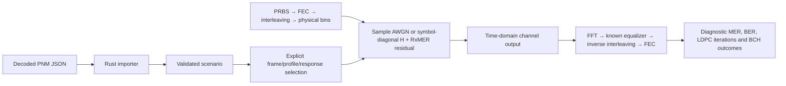

# Waveform impairments

The reference channel remains noiseless by default. Optional sample AWGN or
per-carrier RxMER residuals now pass through actual waveform samples and the
existing receiver, NCP and LDPC/BCH path. They are exclusive noise sources.
No hidden thermal floor is added.

| Component | Design |
| --- | --- |
| Seeded sample-domain Gaussian noise | [AWGN](awgn.md) |
| Current decoder JSON adaptation | [PNM import](pnm-import.md) |
| Carrier-wise residual synthesis and LLR calibration | [RxMER residuals](rxmer.md) |
| Supplied response H and known-reference compensation | [Channel response](channel-response.md) |
| Paired payload constellation before/after compensation | [Paired constellation](paired-constellation.md) |
| Receiver Channel Estimation (CH-EST-RX) | [Pilot estimation and analyzers](../receiver-estimation/README.md) |
| Explicit temporal measurement epochs | [Measurement playback](measurement-timeline.md) |
| CLI experiments and protected LTE sweep | [Running experiments](experiments.md) |

Current waveform support includes uniform16/256 and frozen non-shortened mixed
ProfileA loading through actual FEC. See the [applied-profile design](../payload-transport/applied-profiles.md).
Supplied H and pilot-estimated correction are separate modes. Channel H uses a
synchronized per-symbol diagonal model, not a general linear multipath filter.
Full blind acquisition remains WAVE-RX-05; conditional Gaussian playback does
not imply a field burst/correlation model.
