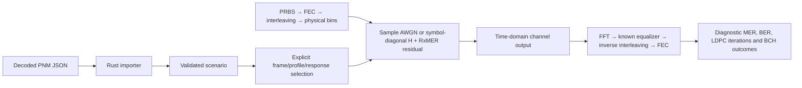

# Waveform impairments

The reference channel remains noiseless by default. Optional sample AWGN or
per-carrier RxMER residuals now pass through actual waveform samples and the
existing receiver, NCP and LDPC/BCH path. They are exclusive noise sources.
No hidden thermal floor is added.

| Component | Design |
| --- | --- |
| Seeded sample-domain Gaussian noise | [AWGN](awgn.md) |
| Current decoder JSON adaptation | [PNM import](pnm-import.md) |
| Carrier-wise residual synthesis and LLR calibration | [RxMER residuals](rxmer.md) |
| Supplied response H and known-reference compensation | [Channel response](channel-response.md) |
| Paired payload constellation before/after compensation | [Paired constellation](paired-constellation.md) |
| CLI experiments and protected LTE sweep | [Running experiments](experiments.md) |

Current waveform payloads remain uniform256-QAM. Imported higher/mixed orders
are retained for analysis but rejected as applied waveform profiles. Channel H
is applied through a synchronized per-symbol diagonal model, not a general
linear multipath filter; blind synchronization/estimation remains unfinished.
These limitations stay explicit under MODEL-05/06 and WAVE-RX-05.
