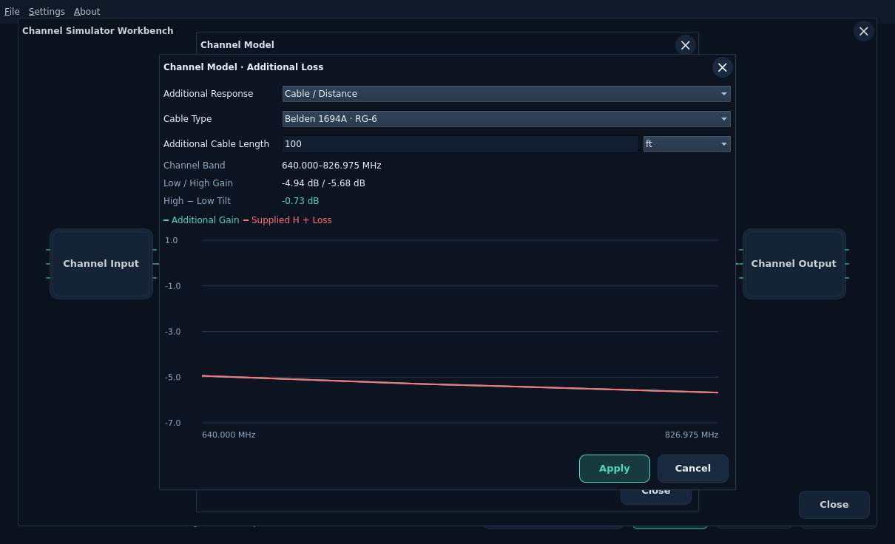
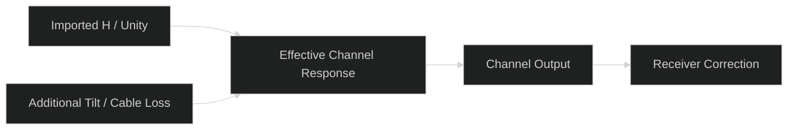

# Additional tilt and cable loss

Open **Channel Simulator → Channel Model → Tilt / Cable Loss**.
Choose a mode, inspect the preview and press **Apply**. Close or X discards edits.
Use the main workbench **Start** to run the accepted model.

| Mode | Controls and behavior |
| --- | --- |
| Off | No additional response; the default for existing workbenches |
| Manual Tilt | High-frequency minus low-frequency gain in dB; −6 dB means the high edge is6 dB lower, with the low edge anchored at0 dB |
| Cable / Distance | Cable type, additional length and ft/m; applies full added attenuation, including low-frequency loss and frequency-dependent tilt |

The preview plots **Additional Gain** and **Supplied H + Loss** over the accepted
channel's physical frequency band. The grid reports low/high gain and total tilt.
For the total response including synthetic echoes, use **Combined Channel Response**
in the Channel Model window. Click that graph to enlarge it.
Imported channel-response and RxMER files remain unchanged. Treat length as cable
added to the supplied response, which may already include cable loss.

The initial cable preset is **Belden 1694A**, using nominal manufacturer attenuation
and linear interpolation between tabulated frequencies. Supported frequency range
is1–3000 MHz. Manual tilt is limited to ±30 dB; cable length to1000 ft / 304.8 m;
additional attenuation to60 dB at any active carrier. These are application limits.
The cable used for SA echo-protection timing is a separate setting; its velocity
factor does not set this model's attenuation.

The current RxMER model specifies noise after channel correction. Both signal
and modeled residual pass through the effective response, so matched receiver
correction can restore the constellation without increasing BER. This control
does not add a receiver noise floor or model distance-related SNR degradation.
It changes magnitude only, not propagation delay, cable echoes or absolute RF power.

Accepted settings save with the workbench JSON. Older workbenches load with Off.
Changing accepted inputs clears old observations; run again to inspect the new
[Channel Input / Output instruments](../channel-measurements.md#channel-simulator-stages).
For model details and data provenance see the
[design](../../development/features/channel-tilt/design.md).

A normalized constellation alone does not establish whether a1000 ft link
reaches an acceptable RF level. The [Channel Simulator power controls](../channel-measurements.md#launch-amplifier-attenuator-and-tappoints)
now provide an explicit TX reference, gain/attenuation, optional independent
receiver noise and calculated Channel Power. Without that reference, experiments
remain relative. A6 MHz equivalent level is separate from total channel power;
detailed RF-port capability and receiver overload modeling remain follow-up work.
