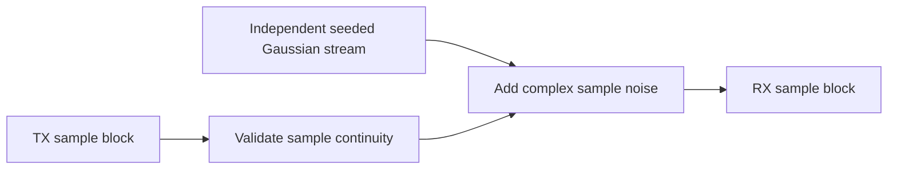

# Sample-domain AWGN

`signal_processing::channel::awgn::SampleAwgn` owns a seeded ChaCha8 Gaussian
stream independent of the PRBS generator. Input is a contiguous bounded
`SampleBlock`; output keeps its indices and original input remains unchanged.

For complex noise power \(P_n\), each real component has variance \(P_n/2\):

\[
 y[m]=x[m]+\sqrt{P_n/2}\,(a_m+j b_m),\qquad a_m,b_m\sim\mathcal N(0,1).
\]

FFT/IFFT normalization is unitary. Consequently independent time-sample noise
of complex variance \(P_n\) produces the same variance per FFT bin. Noise power
is relative to the unit-average data-constellation reference, not measured RF
dBm, dBmV or thermal noise calculated from temperature and impedance. Active-bin
count must not be used to rescale this parameter implicitly.

Zero power is exact passthrough and draws no random numbers. Block splitting
does not reseed or change output. Invalid/discontinuous calls reject before
committing the candidate RNG or sample clock. State is constant-size across long
runs; simulation callbacks observe completed channel input/output blocks.

`examples/channel-awgn.json` selects power0.001, corresponding to approximately
30dB data MER at unity response. Actual diagnostic MER is measured from received
symbols and need not equal the target exactly in a finite run. The initial sample
AWGN mode requires unity H; use the explicitly post-equalization RxMER mode for
supplied H to keep reference-plane choices unambiguous.
