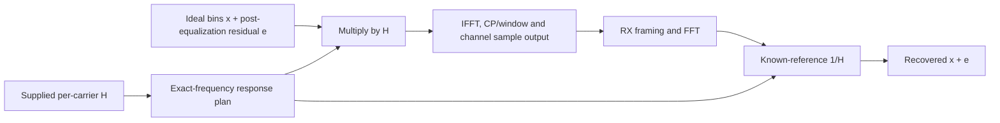

# Supplied channel response and equalization

The imported DS channel-estimation coefficients represent response **H**. Local
CM-SP-CM-OSSIv3.1-I27-250219 AnnexD.2.6, PDF166, states that reciprocals of these
coefficients are typically used as downstream equalizers. They are scaled to
approximately unit average power and do not establish calibrated absolute path loss.
PHY3.1 I20 section9.3.4 also describes this interpretation.

The model is explicitly symbol-diagonal and synchronized:

\[
 Y_k=H_k(X_k+E_k),\qquad R_k=Y_k/H_k=X_k+E_k.
\]

This puts an imported **post-equalization** RxMER budget at its stated reference
plane. Adding equal-strength receiver noise independently and then dividing by H
would amplify that noise again and double-count measured degradation. H-only runs
can select noiseless residuals; measured CLI requests may omit response selection
to use unity H. Zero, unavailable or nonrepresentable active gains reject.

The supplied H is independently copied into the existing known-reference receiver.
It is not estimated from transmitter payload truth. The channel and receiver own
separate transform/window/framing state, and channel input/output plus RX FFT and
equalized test points expose the resulting stages.

The implementation does not convolve arbitrary H across a continuous waveform.
It applies the diagonal response before per-symbol synthesis; it does not model
channel-memory leakage, ISI/ICI, unknown timing or multipath exceeding the cyclic
prefix. Blind estimation and nonideal equalization remain open in MODEL-05 and
WAVE-RX-05. Constant complex and actual frequency-varying captured responses are
tested without claiming those broader receiver capabilities.

## Paired constellation observation

The [paired-constellation collector](paired-constellation.md) retains the same
payload cells before and after this equalizer, with a default target of8192
pairs. Existing raw FFT and equalized boundaries feed an independent diagnostic
inverse interleaver; received NCP ranks select payload samples for bounded
Rust/API/CLI export. This uses supplied H and its reciprocal, without estimating
H from pilots or changing the channel/decoder computations.

If coefficients explicitly represented correction C instead of response H,
channel reconstruction would use1/C and RX would use C. For C=I+jQ:

\[
 C^{-1}=\frac{I-jQ}{I^2+Q^2}.
\]

The current standard PNM input represents H. Its meaning is not inferred from
a filename or changed to match a diagram. The generated constellation is
measurement-conditioned: measured H shape plus synthetic residuals consistent
with RxMER, not the original field-noise realization. Preserve matching grids,
source epochs and explicit tolerance for nonsimultaneous captures.
