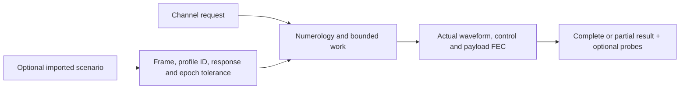

# Running impaired waveform experiments

The [channel CLI](../channel-runner/cli.md) now supports noiseless, sample-AWGN
and selected-measurement operation through the same Rust job lifecycle.



## Controlled AWGN and measured operation

From the repository root, choose new output paths:

```bash
mkdir -p docs/development/local
scripts/cargo-local.sh run -p ofdm-fec-cli --locked -- channel \
  --input examples/channel-awgn.json --output docs/development/local/awgn-channel.json

scripts/cargo-local.sh run -p ofdm-fec-cli --locked -- import-pnm \
  --input examples/measurements/single-channel/import.json \
  --output docs/development/local/demo-scenario.json

scripts/cargo-local.sh run -p ofdm-fec-cli --locked -- channel \
  --input examples/measurements/single-channel/channel-measured.json \
  --scenario docs/development/local/demo-scenario.json --output docs/development/local/measured-channel.json
```

`request.measurement` selects frame index, **profile ID**, optional channel index,
explicit epoch tolerance and noise seed. The measured example uses captured
profile0 (256-QAM) and its exact static PLC/pilot map. Geometry, CP/RP and time
interleaving remain explicit request settings. Data loading must be8bits with
matching protected roles. Unsupported higher/mixed profiles reject, never downgrade.
`channel_index:null` selects unity response; an index selects supplied H.
Do not combine measurement selection with another impairment source.

## Small LTE ingress sweep away from PLC

```bash
scripts/cargo-local.sh run -p docsis-ofdm-fec --example prepare_impairment_runs --locked -- \
  examples/measurements/single-channel docs/development/local/lte-sweep

scripts/cargo-local.sh run -p ofdm-fec-cli --locked -- channel \
  --input docs/development/local/lte-sweep/lte-1rb-request.json \
  --scenario docs/development/local/lte-sweep/lte-1rb-scenario.json \
  --output docs/development/local/lte-sweep/lte-1rb-result.json
```

The generator requires a new directory and creates baseline plus1,6,12,25,50
occupied-resource-block cases, each with a request, scenario and model report.
All use a10MHz nominal LTE-inspired carrier at737.5MHz and, by default,−24dB
core I/S. An optional final numeric argument changes core I/S in dB; for example,
append `-12` to prepare a stronger interference case in a new directory. The
occupied core is RB count times180kHz with500kHz engineering shoulders on each
side, not a validated LTE emission mask or traffic-time model.

The smallest case affects47 of7480 grid positions, approximately0.63%. The full
PLC neighborhood is648–654MHz. Any added envelope overlapping that protected
interval rejects before outputs are created. Original measured residuals remain
in the PLC; only the **added LTE degradation** is kept away. No extra thermal
floor is introduced. Model reports distinguish synthetic scenarios from captures
and retain source identities/timestamps rather than inventing new measurements.

Inspect `status`, error diagnostics, `comparison`, `payload_codeword_errors`,
`payload_ldpc_failures`, `payload_bch_failures`, `bch_corrected_bits`,
`payload_mean_ldpc_iterations` and the actual iteration histogram. Diagnostic
`measured_mer_db` compares equalized data bins against independent transmitted
symbols after reception, never supplies TX truth to a decoder, and is not the
normative pilot-based PNM RxMER measurement. It covers observation-phase data
bins, including filler/NCP where they occupy those physical positions.

An initial syndrome pass can report0 LDPC iterations. LDPC correction can occur
with zero BCH corrections. Control rejection remains a failed/partial run, with
prior completed results retained; it is not silently reported as payload BER0.
NCP moves through the data domain and can still be affected even when PLC is
protected. The current receiver stops on rejected NCP instead of attempting
unverified recovery/resynchronization.

There is no universal15%-of-carriers cutoff. Fraction, depth, bit loading,
interleaving and correlation all matter. These short deterministic examples
illustrate correction/iteration behavior; they are not statistical reliability
or channel-usability guarantees. Longer runs change duration without source resets.

The initial Linux3ms/seed41 sweep recovered254 words and3614928 payload bits per
case with zero bit/codeword errors. The actual iteration counts were:

| Case |0iterations |1iteration |2iterations |
| --- | ---: | ---: | ---: |
| Baseline |254 |0 |0 |
|1RB |91 |163 |0 |
|6RB |12 |242 |0 |
|12RB |2 |252 |0 |
|25RB |0 |254 |0 |
|50RB |0 |249 |5 |

These are observations from this particular short deterministic experiment,
not expected outcomes for every capture or seed. All BCH-corrected-bit counts
were zero: the observed correction workload was handled by LDPC.

## Finding the post-FEC error boundary

A single narrow LTE footprint may remain correctable even with very poor RxMER.
Use a separate synthetic stress case to distinguish impairment depth from width:

```bash
scripts/cargo-local.sh run -p docsis-ofdm-fec --release --locked \
  --example prepare_impairment_runs -- \
  examples/measurements/single-channel docs/development/local/rxmer-stress-12 \
  --stress-mer-db 12

scripts/cargo-local.sh run -p ofdm-fec-cli --release --locked -- channel \
  --input docs/development/local/rxmer-stress-12/rxmer-stress-request.json \
  --scenario docs/development/local/rxmer-stress-12/rxmer-stress-scenario.json \
  --output docs/development/local/rxmer-stress-12/rxmer-stress-result.json
```

This fixture caps available RxMER at the requested dB value on captured static
**data assignments only**, at carrier centers in700MHz inclusive to727MHz
exclusive. Better readings are lowered; already-worse readings and nulls are
retained. Continuous pilots and the full648–654MHz PLC neighborhood are untouched.
It is a27MHz synthetic stress band, **not a single LTE carrier**. The generator
preserves the capture grid, original timestamps and input hashes, and records the
transformation in a sidecar. No extra thermal noise is added.

Each run uses captured256-QAM profile0, seed41, supplied H with known-reference
equalization and3ms duration. Decrease the target in separate new directories,
then inspect actual post-FEC `summary.comparison.bit_errors` and `payload_ber`.
LDPC non-convergence, BCH failure and rejected NCP are separate outcomes; check
`status` and error diagnostics before interpreting a result. There is no universal
RxMER threshold: width, profile, interleaving and seed affect the result.

Both preparation and simulation execute Rust command-line programs. A sweep
launcher may invoke them repeatedly and collect JSON statistics, but it performs
no signal processing or decoding itself.

On Linux with the supplied capture and these fixed settings,1072 of7480 captured
positions (14.33%) were degraded. Each completed case compared3614928 payload
bits across254 words, with no PLC bit errors. A coarse sweep from30dB downward
was refined between12 and9dB:

| Stress-band RxMER | Post-FEC bit errors | Post-FEC BER | Mean LDPC iterations | LDPC-failed words |
| --- | ---: | ---: | ---: | ---: |
|15dB |0 |0 |3.33 |0 |
|12dB |0 |0 |6.22 |0 |
|11dB |483 |0.0001336 |9.93 |2 |
|10dB |28187 |0.0077974 |35.26 |132 |
|9dB |74575 |0.0206297 |50.00 |254 |

The first tested failing point was11dB, bracketed by the error-free12dB case.
At10dB, BCH corrected12 bits across the run but131 words still failed BCH.
At9dB, all254 words hit the50-iteration LDPC limit and failed BCH. All cases
completed without NCP rejection. These are actual recovered-payload errors, not
raw pre-LDPC decisions or an analytical MER estimate. A stronger single10MHz
LTE-shaped footprint still produced no post-FEC errors in this short experiment;
the wider stress case deliberately changes the affected fraction.

## View the tested RxMER inputs as binary PNM files

The [binary demo folder](../../../examples/measurements/rxmer-fec-stress/README.md)
contains the original baseline and the12,11,10,9dB stress variants. Open each
`.bin` file in the viewer's single-capture workspace. Every exported sample was
verified through `pnm-decode` against the corresponding simulation scenario.
These are alternative scenarios with the same original timestamp, not a time
series. The folder includes reproducible Rust export commands and provenance.
