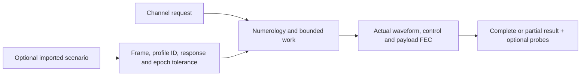

# Running impaired waveform experiments

The [channel CLI](../channel-runner/cli.md) now supports noiseless, sample-AWGN
and selected-measurement operation through the same Rust job lifecycle.



## Controlled AWGN and measured operation

From the repository root, choose new output paths:

```bash
scripts/cargo-local.sh run -p ofdm-fec-cli --locked -- channel \
  --input examples/channel-awgn.json --output development/awgn-channel.json

scripts/cargo-local.sh run -p ofdm-fec-cli --locked -- import-pnm \
  --input examples/measurements/single-channel/import.json \
  --output development/demo-scenario.json

scripts/cargo-local.sh run -p ofdm-fec-cli --locked -- channel \
  --input examples/measurements/single-channel/channel-measured.json \
  --scenario development/demo-scenario.json --output development/measured-channel.json
```

`request.measurement` selects frame index, **profile ID**, optional channel index,
explicit epoch tolerance and noise seed. The measured example uses captured
profile0 (256-QAM) and its exact static PLC/pilot map. Geometry, CP/RP and time
interleaving remain explicit request settings. Data loading must be8bits with
matching protected roles. Unsupported higher/mixed profiles reject, never downgrade.
`channel_index:null` selects unity response; an index selects supplied H.
Do not combine measurement selection with another impairment source.

## Small LTE ingress sweep away from PLC

```bash
scripts/cargo-local.sh run -p docsis-ofdm-fec --example prepare_impairment_runs --locked -- \
  examples/measurements/single-channel development/lte-sweep

scripts/cargo-local.sh run -p ofdm-fec-cli --locked -- channel \
  --input development/lte-sweep/lte-1rb-request.json \
  --scenario development/lte-sweep/lte-1rb-scenario.json \
  --output development/lte-sweep/lte-1rb-result.json
```

The generator requires a new directory and creates baseline plus1,6,12,25,50
occupied-resource-block cases, each with a request, scenario and model report.
All use a10MHz nominal LTE-inspired carrier at737.5MHz and−24dB core I/S. The
occupied core is RB count times180kHz with500kHz engineering shoulders on each
side, not a validated LTE emission mask or traffic-time model.

The smallest case affects47 of7480 grid positions, approximately0.63%. The full
PLC neighborhood is648–654MHz. Any added envelope overlapping that protected
interval rejects before outputs are created. Original measured residuals remain
in the PLC; only the **added LTE degradation** is kept away. No extra thermal
floor is introduced. Model reports distinguish synthetic scenarios from captures
and retain source identities/timestamps rather than inventing new measurements.

Inspect `status`, error diagnostics, `comparison`, `payload_codeword_errors`,
`payload_ldpc_failures`, `payload_bch_failures`, `bch_corrected_bits`,
`payload_mean_ldpc_iterations` and the actual iteration histogram. Diagnostic
`measured_mer_db` compares equalized data bins against independent transmitted
symbols after reception, never supplies TX truth to a decoder, and is not the
normative pilot-based PNM RxMER measurement. It covers observation-phase data
bins, including filler/NCP where they occupy those physical positions.

An initial syndrome pass can report0 LDPC iterations. LDPC correction can occur
with zero BCH corrections. Control rejection remains a failed/partial run, with
prior completed results retained; it is not silently reported as payload BER0.
NCP moves through the data domain and can still be affected even when PLC is
protected. The current receiver stops on rejected NCP instead of attempting
unverified recovery/resynchronization.

There is no universal15%-of-carriers cutoff. Fraction, depth, bit loading,
interleaving and correlation all matter. These short deterministic examples
illustrate correction/iteration behavior; they are not statistical reliability
or channel-usability guarantees. Longer runs change duration without source resets.

The initial Linux3ms/seed41 sweep recovered254 words and3614928 payload bits per
case with zero bit/codeword errors. The actual iteration counts were:

| Case |0iterations |1iteration |2iterations |
| --- | ---: | ---: | ---: |
| Baseline |254 |0 |0 |
|1RB |91 |163 |0 |
|6RB |12 |242 |0 |
|12RB |2 |252 |0 |
|25RB |0 |254 |0 |
|50RB |0 |249 |5 |

These are observations from this particular short deterministic experiment,
not expected outcomes for every capture or seed. All BCH-corrected-bit counts
were zero: the observed correction workload was handled by LDPC.
