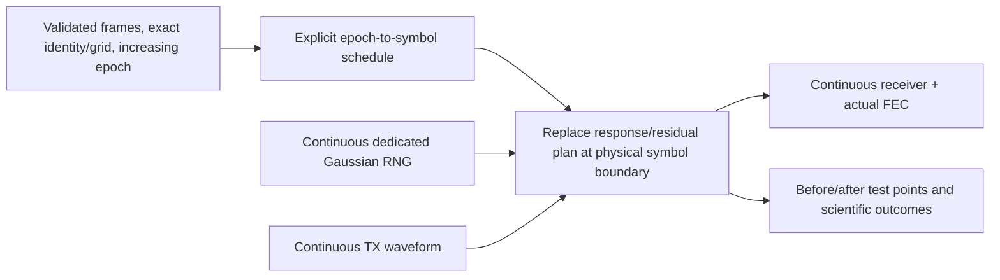

# Measurement epochs and temporal residuals

The channel can now play a piecewise-constant sequence of supplied RxMER/response
frames while preserving source, coding/interleaver, noise-generator and waveform
history. The applied profile and physical layout remain frozen for the run.
Changing profile activation or geometry mid-codeword is outside this mode.



Extend a measurement selection with explicit later source indexes:

```json
"measurement": {
  "frame_index": 0, "profile_id": 0, "channel_index": 0,
  "tolerance_seconds": 90000, "noise_seed": 41,
  "transitions": [{"frame_index": 1, "channel_index": 1}]
}
```

This fragment requires a scenario containing both RxMER frames/responses and a
matching ProfileA. Original capture timestamps and provenance are preserved.
Frames must share an exact MAC/channel/grid and have strictly increasing epochs;
profile and each selected response must meet the configured epoch tolerance.
No filename sorting, implicit alignment, interpolation of source measurements or
silent substitution of a missing response is performed.

The baseline starts at physical payload-observation offset0. A later capture at
integer epoch difference delta seconds is applied at:

\[
q=\left\lceil\frac{\Delta t\,f_s}{N+N_{CP}}\right\rceil.
\]

Thus it never takes effect before its recorded time. Acquisition precedes the
observation clock; the final plan is held through completion/drain. Transitions
must be strictly inside the configured observation duration. A caller can also
supply explicit typed `impairment_timeline` entries with symbol offsets, original
capture times and full impairment settings. Choose imported transitions or direct
entries, not both. Direct symbol schedules are an explicit playback policy rather
than an inferred measurement time scale.

All epochs use one noise seed and continuous RNG state. At most4096 transitions
and4 million retained frame samples are accepted. Active coverage/null/response
checks apply to every epoch before scientific work starts.

## Temporal model and its limits

Within an epoch, the residual is independent circular complex Gaussian noise:

\[
E_{k,t}\sim\mathcal{CN}(0,v_{k,q}),\quad
v_{k,q}=10^{-\mathrm{RxMER}_{k,q}/10},\quad
Y_{k,t}=H_{k,q}(X_{k,t}+E_{k,t}).
\]

The conditional mean is zero; independent distinct draws have zero expected
cross-correlation. Variance can jump at an explicitly selected epoch. This does
not infer impulse timing, burst duration, duty cycle or correlated ingress from
RxMER. A future burst model needs its own explicit inputs and independent tests.
No hidden thermal floor or second noise source is added.

Tests verify two independently expected residual-power levels and near-zero lag
correlation, reject invalid timelines, and prove an identical-coefficient epoch
transition leaves the entire FEC/scientific summary unchanged. These are tests
of this stated Gaussian piecewise model, not field burst statistics.
