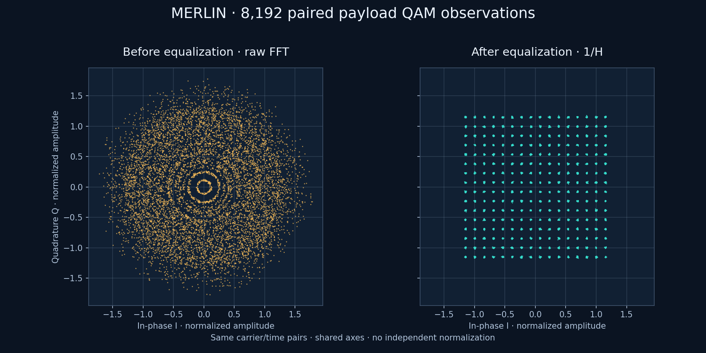
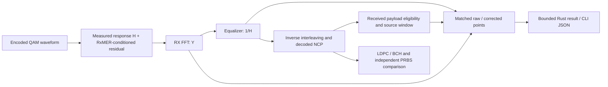
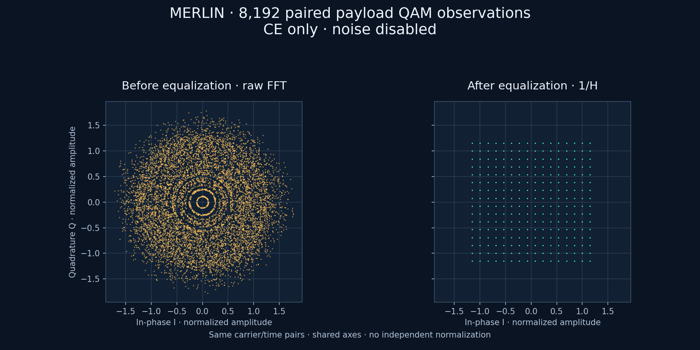

# Before and after equalization

The channel runner can retain **matched payload QAM observations before and after
receiver equalization**. The same typed Rust result is available through the
library and the `channel` CLI. Collection is opt-in; it does not feed the decoder.



A [standalone pre-CE scatter plot](../../images/constellation-pre-ce.png) shows
the same raw FFT samples without the corrected panel.

This image uses all8,192 exported pairs from the supplied demonstration capture,
uniform256-QAM profile0,700–727MHz selection and seed41. Both panels have shared
axes. The raw view combines carrier-dependent rotations/gains; the corrected
view retains the measured RxMER residual. These are actual stage values, not
points synthesized by a plotter or independently normalized panels.

## What this shows



The standard DS channel-estimation PNM supplies response H, while its complex
reciprocal is the receiver correction. With ideal cell X and post-equalization
residual E:

\[
 Y=H(X+E),\qquad Z=Y/H=X+E.
\]

The [response guide](channel-response.md) records the reference plane and pinned
specification evidence. The correction removes modeled H, not the RxMER residual.
No extra thermal noise is added. A hypothetical correction-coefficient input C
would require1/C for the channel and C for RX; that input mode is not implemented
or inferred from a filename.

## CE-only demonstration: no added noise



This separate run uses the same measured H, profile0,700–727MHz selection and
8192 matched observations, with `impairments.noise.mode` set to `noiseless`.
It supplies the unchanged typed response directly through `impairments.response`;
it does not select `measurement`, which would activate the captured RxMER residual.
The result has zero payload bit errors and zero mean LDPC iterations.

Here Y=HX and Z=Y/H=X, apart from floating-point transform error. Raw points can
still form rings because the plot combines differently rotated/scaled carriers.
That structure is channel response, not injected noise. After correction the
points fall on the256-QAM grid. The paired panels share axes; there is no separate
amplitude or phase normalization. [Raw-only](../../images/constellation-ce-only-before.png)
and [corrected-only](../../images/constellation-ce-only-after.png) images are also
available; their plot axes autoscale when rendered independently.

For a direct Rust experiment, resolve/validate the existing measured settings,
then set `settings.impairments.noise = NoiseModel::Noiseless` before constructing
the run. Preserve `settings.impairments.response`. The positive `llr_variance`
remains a demapper reference and does not inject noise. A CLI request can provide
those same unchanged typed response coefficients under `impairments.response`
with `noise: {"mode":"noiseless"}` and omit `measurement`/`--scenario`.

## Test points behind the graphs

| Boundary | Existing test-point ID | Values shown |
| --- | --- | --- |
| Before correction | `rx.fft.bins` | Received physical FFT-bin I/Q before the equalizer. |
| After correction | `rx.equalized.iq` | I/Q after the known-reference1/H correction. |

The paired collector uses those same receiver-stage arrays and received payload
classification to match both points by carrier and receive time. Generic bounded
JSONL probes can inspect either stage independently, including nonpayload bins;
they do not automatically provide the payload filtering or matched-pair ordering
of `result.constellation`. Use the [probe-export guide](../simulation/probe-export.md)
for generic stage selection and the paired result below for the plotted data.

## Select the capture

Add this optional object to an existing channel request:

```json
"constellation": {
  "requested_pairs": 8192,
  "profile_id": 0,
  "start_hz": 700000000,
  "stop_hz": 727000000
}
```

This is a request fragment; use the linked complete examples below. An empty
`"constellation": {}` chooses8192 observations across the supported profile.
Omitting `constellation`, or setting it to null, disables collection.

| Setting | Meaning |
| --- | --- |
| `requested_pairs` | Total actual paired QAM cells for the selection; default8192, allowed1..65536. These are not whole OFDM symbols or points per constellation location. |
| `profile_id` | Current waveform payload profile0, uniform256-QAM. Other applied profiles reject. |
| `start_hz`, `stop_hz` | Optional inclusive physical carrier-center interval. Supply both or neither. Equal bounds select a single carrier. Bounds must lie inside the static data envelope and include at least one eligible center. |

A carrier can be statically eligible but carry a pilot or control cell at a
particular time. Selection uses actual received NCP payload ranks after inverse
interleaving, excluding PLC, pilots, NCP, filler and unknown startup history.
Payloads that later fail LDPC/BCH stay eligible. No transmitter truth/word IDs
are used to classify received cells.

Only cells belonging to the configured source-observation interval are selected.
A cell received during drain can still belong to that interval. Points are
returned in increasing received channel-symbol/physical-bin order after a bounded
classification delay. This is the first eligible set, not random sampling.

## Run the measured example

From the repository root, choose fresh output paths:

```bash
scripts/cargo-local.sh build -p ofdm-fec-cli --release --locked
mkdir -p docs/development/local/paired-constellation-demo

target/release/ofdm-fec import-pnm \
  --input examples/measurements/single-channel/import.json \
  --output docs/development/local/paired-constellation-demo/scenario.json

target/release/ofdm-fec channel \
  --input examples/measurements/single-channel/channel-constellation.json \
  --scenario docs/development/local/paired-constellation-demo/scenario.json \
  --output docs/development/local/paired-constellation-demo/result.json
```

The [measured request](../../../examples/measurements/single-channel/channel-constellation.json)
uses3ms, the captured profile0, supplied H and the existing explicit90000-second
capture tolerance. It exports8192 matched pairs. These capture timestamps differ;
the tolerance is a demo choice, not an assumption of simultaneous measurements.
A standalone noiseless [request](../../../examples/channel-constellation.json)
needs no scenario; run it through the same `channel` command without `--scenario`.

## Read the result

`result.constellation` is omitted when disabled. When enabled:

| Field | Meaning |
| --- | --- |
| `schema_version` | Paired capture schema1. |
| `selection` | Requested count, supported profile and inclusive bounds. |
| `status` | `complete` when the target is met, `partial` for fewer nonzero pairs, `unavailable` for zero pairs. Independent of enclosing job/FEC status. |
| `collected_pairs` | Actual retained pair count; exactly the length of `pairs`. |
| `reference` | Raw receiver I/Q with a shared unit-RMS reference and no display normalization. |
| `channel_coefficients` | Response-H / receiver-reciprocal convention; unity response is the special noiseless reference case. |
| `pairs` | One record per actual payload observation, containing both I/Q points and their shared coordinates. |

Each pair contains `before_equalization`, `after_equalization`, `physical_bin`,
`frequency_hz`, `channel_symbol_index`, `source_symbol_index`, `data_position`,
`profile_id` and `modulation_order`. `data_position` is its source-order rank
among nonpilot cells; it is not the physical FFT-bin number. No sample values
are rounded for export. Input provenance remains in the enclosing run's selected
RxMER/response settings.

The run retains at most the requested number of pairs. A separate diagnostic
inverse interleaver and bounded reorder map account for attribution latency;
collection stops retaining/transporting diagnostics after the target is met.
Scientific processing continues unchanged. Cancellation, runtime expiry and
terminal stage/probe failures preserve previously confirmed pairs. Unclassified
points are not guessed after bad NCP. Explicitly taking a partial capture through
the Rust stepper stops further retention without stopping the scientific session.

A short run or narrow/single-carrier selection can produce fewer points than
requested. The runner does not pad, repeat points, extend duration or reseed to
reach the target. The CLI retains its16MiB result limit, so a large requested
count plus bulky measurement settings may exceed output capacity. In that case
serialization rejects before creating the destination; choose a smaller count or
use the direct Rust result. Existing destinations are never replaced.

## Reproduce the documentation plot

The optional plotter only draws exported Rust values; it performs no DSP, noise
modeling, normalization, FEC or scientific-statistics calculation. It uses
Matplotlib3.10.8 in an isolated, ignored environment; the simulator does not
require Python or Matplotlib.

```bash
python3 -m venv local/doc-plots
local/doc-plots/bin/python -m pip install matplotlib==3.10.8
MPLCONFIGDIR=docs/development/local/plot-cache \
  local/doc-plots/bin/python tools/plots/constellation/render.py \
  docs/development/local/paired-constellation-demo/result.json \
  docs/development/local/paired-constellation-demo/plot.png
```

The renderer accepts `--view before` for raw pre-CE points, `--view after` for
corrected points, or the default `--view paired` for both. For example, append
`--view before` and choose a new output filename for the standalone raw plot.
No equalization, phase alignment or point normalization is performed by the plotter.

The plot destination must be new. Paired panels share axes and reference scaling;
select a single carrier or narrower interval to distinguish its behavior from
whole-channel mixing of different gains/phases.

## Interpretation and validation

This is a **measurement-conditioned simulation**, not a recording of the field
constellation. H supplies measured relative amplitude/phase shape, while RxMER
supplies residual power. Gaussian samples are generated, not recovered from the
field. Identity/grid and time differences remain explicit. Matching supplied H
and1/H are an ideal known-coefficient baseline; independent pilot estimation,
unknown timing, general FIR multipath and mixed waveform profiles remain open.

Tests cover both spacings at maximum depth, independent square256-QAM geometry,
physical/source-coordinate arithmetic, exact pair count/order, single-carrier
partial results, invalid selections, cancellation/probe failure, failed payloads,
receive-block splitting and unchanged FEC/noise outcomes. The actual release CLI
also exported8192 measured pairs; a11dB stress case retained483 payload errors
with its entire scientific summary unchanged from the earlier no-collector run.
See the [implementation record](../../development/features/paired-constellation/implementation.md)
for ownership, ordering bounds and validation scope. No Qt scatter UI is included.
