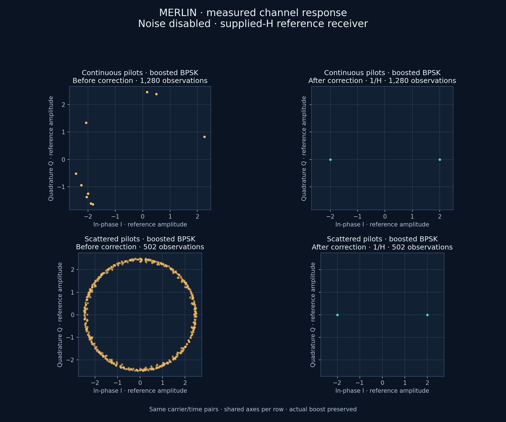
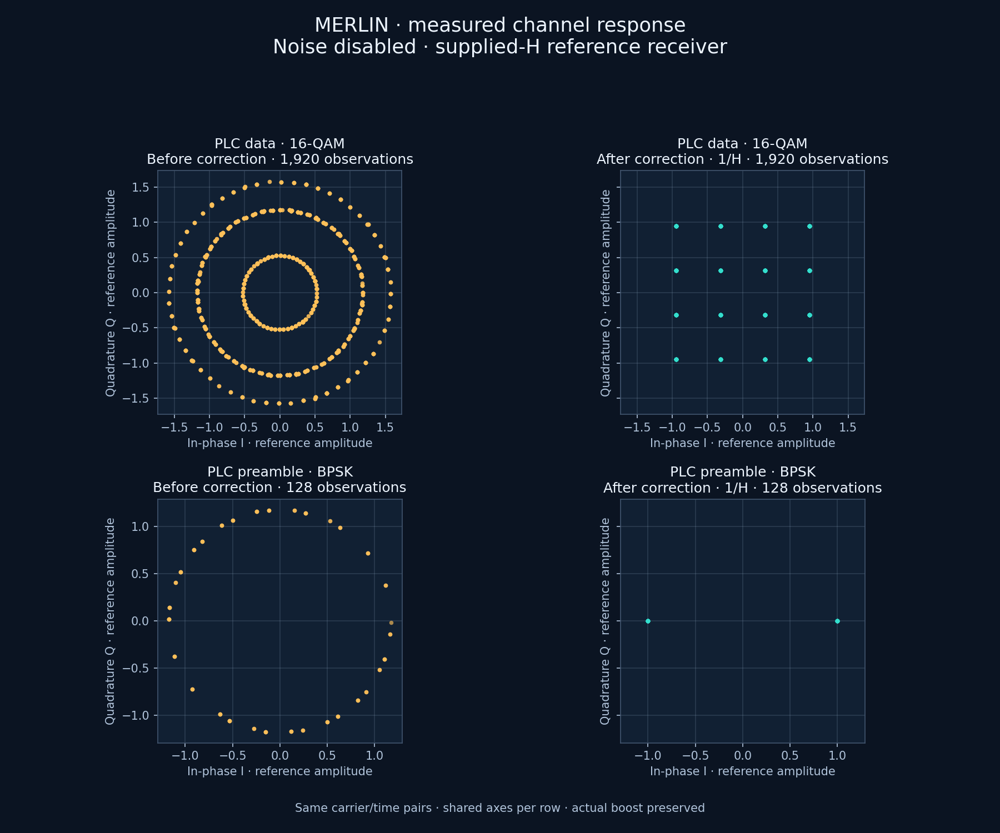
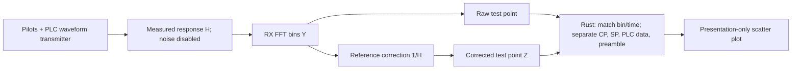

# Pilot and PLC constellation demonstration

This CE-only simulation sends the existing continuous pilots, scattered pilots,
PLC data and PLC preamble through the measured downstream channel response H.
It captures the actual received FFT bins before correction and the same bins
following the reference receiver's1/H correction. No noise is injected.



Pilots use boosted BPSK. Their corrected points lie at I=−2 or+2 with Q=0.
Different carriers have different channel gain/phase, so their raw points spread
around the origin even without noise. Continuous pilots repeatedly occupy their
fixed bins; scattered pilots sample changing bins across the symbol phases.
Many observations overlap on the same visible points.



PLC data uses16-QAM; its corrected points recover the16-point grid. The PLC
preamble uses BPSK and returns to I=−1 or+1, Q=0. The plotter preserves actual
amplitudes, uses shared axes within each row and never normalizes either panel.
See the [pilot design](../pilot-signals.md) and [PLC design](../plc-channel.md)
for sequences, boost, coding and framing, pinned to PHY I20 sections7.5.

## Signal path and math



For transmitted reference X at physical carrier k and symbol t:

\[
Y_{k,t}=H_kX_{k,t},\qquad Z_{k,t}=Y_{k,t}/H_k=X_{k,t}.
\]

The independently checked corrected constellations are:

\[
X_{\mathrm{pilot}}\in\{-2,+2\}+j0,\qquad
X_{\mathrm{preamble}}\in\{-1,+1\}+j0,
\]

\[
X_{\mathrm{PLC\ data}}=(I+jQ)/\sqrt{10},\qquad
I,Q\in\{-3,-1,+1,+3\}.
\]

This is the supplied-H validation baseline, with known timing and PLC phase.
The receiver does not yet estimate H from the pilots. The
[receiver estimator](../../development/features/pilot-channel-estimation/plan.md)
is checked against this baseline; see the
[new receiver guides](../receiver-estimation/README.md) for implemented scope. These simulated constellations use a
measured response; they are not recovered field I/Q recordings.

## Reproduce the Rust simulation

From the repository root, choose fresh output destinations:

```bash
scripts/cargo-local.sh build -p ofdm-fec-cli --release --locked
mkdir -p docs/development/local/protected-scatter

target/release/ofdm-fec import-pnm \
  --input examples/measurements/single-channel/import.json \
  --output docs/development/local/protected-scatter/scenario.json

scripts/cargo-local.sh run -p docsis-ofdm-fec \
  --example protected_scatter --release --locked -- \
  examples/measurements/single-channel/channel-constellation.json \
  docs/development/local/protected-scatter/result.json \
  docs/development/local/protected-scatter/scenario.json
```

The example resolves the same shared Rust request/scenario settings, preserves H,
explicitly sets noise to `noiseless`, and disables the payload-pair collector.
The optional third argument is a scenario; omit it for a request already carrying
`impairments.response`. Missing H, oversized input/output and existing output
files are rejected. All simulation and numerical validation run in Rust.

It selects one complete128-symbol acquisition frame, including120 PLC data
symbols and8 preamble symbols. It stops at that frame boundary rather than
claiming a completed payload run. The selected bins are the PLC strip plus up
to256 context bins on either side, clipped to the active envelope. This bounds
both probe stages within the existing observation budget.

For the included25kHz measured example, physical bins532–1059 cover
644.400–657.575MHz; PLC bins788–803 cover650.800–651.175MHz.
The retained sample counts are:

| Stream | Paired observations |
| --- | ---: |
| Continuous pilots | 1280 |
| Scattered pilots | 502 |
| PLC data | 1920 |
| PLC preamble | 128 |

JSON preserves the effective settings and response provenance, physical bin,
frequency, channel-symbol index and both I/Q points. `counts` and `probe_stats`
make the finite selection explicit. This example uses existing `rx.fft.bins`
and `rx.equalized.iq` probes; it does not add pilot/PLC fields to the production
CLI constellation contract.

The example verifies every corrected point against its independent BPSK or
16-QAM grid with absolute tolerance1e−8. It also verifies Y=HZ for every pair.
The measured run dispatched256 events/135168 elements without callback errors,
completed one PLC frame with zero PLC bit errors, and had maximum corrected-bin
error approximately2.44e−15. Payload BER is unavailable because payload
transmission has not begun at this acquisition boundary.

## Render the exported points

With the optional development matplotlib environment already installed:

```bash
MPLCONFIGDIR=docs/development/local/protected-scatter/matplotlib \
  local/doc-plots/bin/python tools/plots/protected-signals/render.py \
  docs/development/local/protected-scatter/result.json \
  docs/development/local/protected-scatter/pilots.png --group pilots

MPLCONFIGDIR=docs/development/local/protected-scatter/matplotlib \
  local/doc-plots/bin/python tools/plots/protected-signals/render.py \
  docs/development/local/protected-scatter/result.json \
  docs/development/local/protected-scatter/plc.png --group plc
```

The renderer only selects the exported streams and draws their unchanged points.
It performs no DSP, equalization, noise generation or scientific statistics.
Output files must be new. Matplotlib is optional development tooling, not a
scientific runtime dependency.
