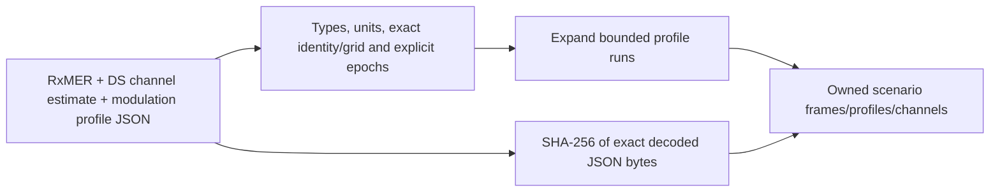

# Importing current pnm-decode JSON

`scenario::pnm_json` converts current decoder JSON to the existing standalone
scenario types. It takes borrowed named JSON byte slices, not paths or viewer
objects. The CLI `import-pnm` command is the filesystem adapter.



Currently supported documents are PNN/PNM types4,2,10, format1.0, using range
profile schemes. Unknown ancillary derived JSON fields are ignored; authoritative
assignment codes must agree with supplied names, bit loading and carrier roles.
Other scheme/format encodings reject explicitly. Full upstream schema/version
compatibility remains INPUT-02; verified fixture producer is `pnm-decode0.3.6`.

Each JSON input is bounded to16MiB; source grids and expanded scenario work are
bounded before excessive profile expansion. Lengths, finite numbers, units,
MAC/channel, zero frequency, first carrier index, spacing and profile coverage
must agree. Nulls stay null. No input is resampled, relabeled or silently repaired.
Source epochs stay separate. The caller explicitly sets the maximum timestamp
distance from RxMER for both other captures; zero means exact simultaneity.

Provenance hashes and lengths identify the **decoded JSON bytes**. Original
binary capture hashes are unavailable from ordinary decoder JSON and are not
invented. The demo's existing provenance file retains those binary identities
separately. Imported channel coefficients mean relative response H, not1/H.

From the repository root:

```bash
mkdir -p docs/development/local
scripts/cargo-local.sh run -p ofdm-fec-cli --locked -- import-pnm \
  --input examples/measurements/single-channel/import.json \
  --output docs/development/local/demo-scenario.json
```

Capture paths in an import request resolve relative to that request. The demo's
explicit90000-second tolerance permits its nonsimultaneous lab sources; it is
not a recommended production default. Output destinations are never replaced.
See [experiments](experiments.md) for using the resulting scenario with waveform RX.
