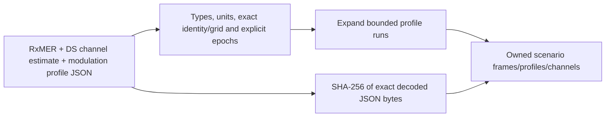

# Importing current pnm-decode JSON

`scenario::pnm_json` converts current decoder JSON to the existing standalone
scenario types. It takes borrowed named JSON byte slices, not paths or viewer
objects. The CLI `import-pnm` command is the filesystem adapter.



Currently supported documents are PNN/PNM types4,2,10, format1.0, using range
profile schemes. Unknown ancillary derived JSON fields are ignored; authoritative
assignment codes must agree with supplied names, bit loading and carrier roles.
Other scheme/format encodings reject explicitly. The explicit INPUT-02 producer contract below pins verified fixture producer
`pnm-decode0.3.6`.

Each JSON input is bounded to16MiB; source grids and expanded scenario work are
bounded before excessive profile expansion. Lengths, finite numbers, units,
MAC/channel, zero frequency, first carrier index, spacing and profile coverage
must agree. Nulls stay null. No input is resampled, relabeled or silently repaired.
Source epochs stay separate. The caller explicitly sets the maximum timestamp
distance from RxMER for both other captures; zero means exact simultaneity.

Provenance hashes and lengths identify the **decoded JSON bytes**. Original
binary capture hashes are unavailable from ordinary decoder JSON and are not
invented. The demo's existing provenance file retains those binary identities
separately. Imported channel coefficients mean relative response H, not1/H.

From the repository root:

```bash
mkdir -p docs/development/local
scripts/cargo-local.sh run -p ofdm-fec-cli --locked -- import-pnm \
  --input examples/measurements/single-channel/import.json \
  --output docs/development/local/demo-scenario.json
```

Capture paths in an import request resolve relative to that request. The demo's
explicit90000-second tolerance permits its nonsimultaneous lab sources; it is
not a recommended production default. Output destinations are never replaced.
See [experiments](experiments.md) for using the resulting scenario with waveform RX.

## Explicit decoder contract (INPUT-02)

New CLI requests use `schema_version: 2` and include:

```json
"decoder_contract": {
  "revision": 1,
  "producer": "pnm-decode",
  "producer_version": "0.3.6"
}
```

The three files must come from that declared export record. Ordinary decoded PNM
JSON does not identify its producer version; the adapter cannot authenticate a
self-declaration. Keep the import request with its resulting scenario. The scenario
format is unchanged and its hashes still identify the exact input JSON bytes.

Revision1 explicitly supports only0.3.6, as verified against the checked-in exports.
Unknown producer, producer version or contract revision rejects **before parsing
captures**. Supporting a later producer requires verifying its exports and updating
the allowlist/tests deliberately. Binary PNM format1.0, decoder version0.3.6,
import-request schema2 and contract revision1 are distinct identifiers.

Required fields and units retain the preceding validation. Extra ancillary decoder
fields are accepted for additive compatibility; they cannot override required
coordinates, assignment codes or units. Renamed/removed required fields or changed
types/units reject. Extra contract-envelope fields reject.

Legacy request schema1 remains available only without `decoder_contract`. The
original `import` Rust API is that legacy adapter; `import_with_contract` enforces
the producer declaration. A schema2 request without its contract, or a schema1
request with one, rejects. The checked-in demo now uses schema2.

## Synthetic channel-width tests

The [24 MHz and 90 MHz examples](../../../examples/measurements/channel-widths/README.md)
provide aligned RxMER/channel JSON plus four profiles (256/1024/2048/4096-QAM).
They include CLI import and noiseless channel requests for each profile. These
are generated ideal inputs, not additional captured measurements. The fixed
runner applies each selected loading as its internal Profile A; imported IDs
remain unchanged, and measured-selector support remains restricted to ID 0.
