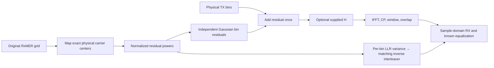

# Per-carrier RxMER residuals

RxMER is the sole total residual-error budget in this mode. The waveform starts
noiseless; no extra AWGN, system or thermal floor is added. For data-constellation
reference power one, complex post-equalization residual power is

\[
 P_{e,k}=10^{-M_k/10}.
\]

PHY3.1 I20 section9.3.6, PDF187, defines the numerator using ideal **data** QAM
power, excluding pilot boost. Therefore boosted pilots do not receive an extra
fourfold residual variance. This relation and the channel-response interpretation
were checked against local versioned text; no rendered-PDF verification is claimed.

The frozen plan exposes full-grid H, residual powers and per-bin LLR variances.
Carrier matching uses absolute Hz and exact spacing; selecting a covered subband
does not rewrite measurement headers. Missing MER or missing/zero H on active
data/control/pilot bins rejects before the run. Excluded bins require no reading
and receive no synthesized residual. Scalars outside the finite representable
simulation range reject rather than being clamped.

Independent complex Gaussian bins are an explicit residual-distribution
assumption. Noise passes through IFFT, CP, window and overlap-add, producing real
channel output sample blocks. This construction is symbol-synchronous colored
Gaussian noise, not reconstruction of an LTE waveform, thermal noise spectrum or
unmeasured temporal/burst correlations. The ordinary sample-AWGN mode remains
distinct and cannot be combined with these total residuals.

Variance metadata follows the same frequency/time inverse permutation and delay
as each received payload/NCP cell. Demappers then scale each LLR with that cell's
variance. The original scalar-variance receive APIs remain wrappers. PLC decoding
currently uses the mean variance across its fixed bins, a documented calibration
approximation when those PLC readings vary. No waveform impairment is hidden
behind a change to LLR scale alone.

The LTE-derived RxMER fixtures already contain baseline plus ingress. Applying
them once is sufficient; do not add the LTE model or original baseline again.
