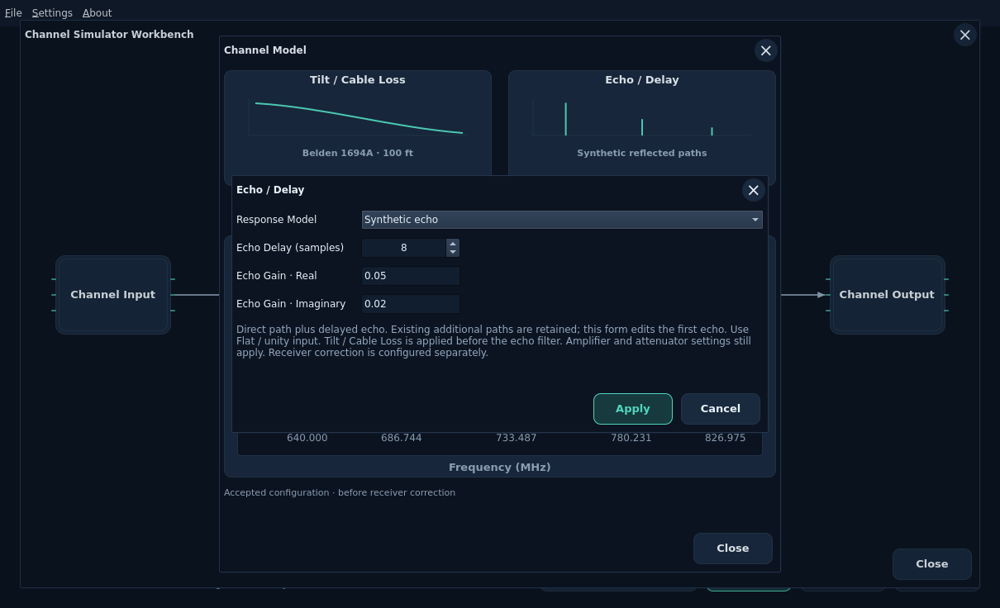
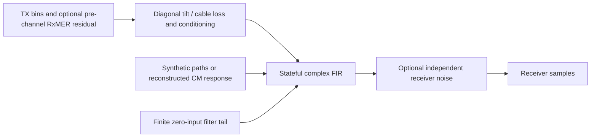
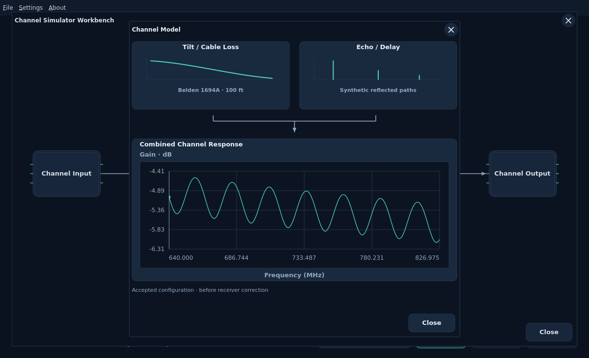
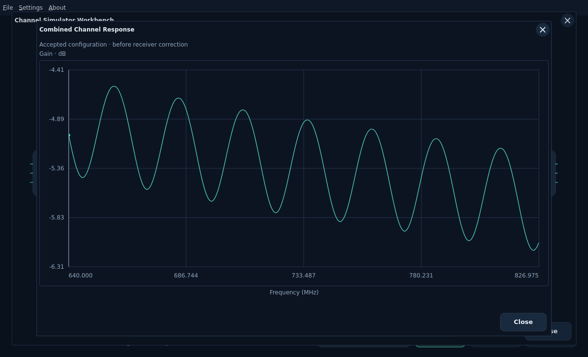

# Continuous waveform channel filtering

[Documentation index](../../README.md)

Open **Channel Simulator → Channel Model → Echo / Delay**. The selected
response model is independent of MCE and persists with accepted run settings in
the WB. Apply validates the draft; Cancel/X discards it. Stop an active run before
applying changes.

| Response model | Behavior |
| --- | --- |
| Per-subcarrier reference (default) | Existing synchronized diagonal H application. No continuous channel memory. |
| Synthetic echo | Direct path plus integer-delay echo; existing additional paths are retained when editing the first echo. Uses Flat / unity input. Tilt / Cable Loss and scalar conditioning are applied before the echo filter. |
| CM capture · continuous FIR | Explicit finite causal reconstruction of supplied H, applied to continuous samples across symbol boundaries. |

The filter computes \(y[n]=\sum_\ell h[\ell]x[n-\ell]\) and retains history
across sample blocks, OFDM symbols, codewords and PLC frames. Delays are integer
sample ticks at 204.8 Msamples/s. No fractional-delay or physical-distance estimate
is implied. Rust accepts up to 32 distinct paths with a direct path at delay zero;
the UI edits the first delayed path using real/imaginary complex gain. It preserves
other saved paths. Memory is capped at 2048 samples (10 µs), with at most 2049
coefficients. These are application limits, not DOCSIS channel requirements.

Sparse filters use delay lines with at most 32 nonzero coefficients. Dense filters
use 8192-point FFT overlap-add in input chunks of at most 4096 samples, avoiding
an unrestricted samples-times-filter-length loop. The filter flushes exactly L−1
samples once. Results report this channel tail separately from transmitter window
overlap and interleaver drain. Seeded noise state is not reset at boundaries.

## Combining loss and echoes

The Channel Model window has graphic **Tilt / Cable Loss** and **Echo / Delay**
controls feeding **Combined Channel Response**. RxMER and DS Channel Estimate
remain in their existing workbench blocks without duplicate controls here.
Open either card to edit its
settings. Click the combined graph for a larger view. It previews accepted
configuration before receiver correction; it does not require Start or substitute
for measured RxMER, received I/Q or an MCE estimate. Missing DPD or unsupported
combinations show a diagnostic instead of a made-up trace.

With synthetic echoes, the shared Rust planner composes
\(H_{total}(k)=H_{loss}(k)H_{echo}(k)\), including scalar conditioning once.
Magnitude-only loss is applied on the existing diagonal OFDM grid, then samples
pass through the stateful echo filter. Loss adds no physical propagation delay;
only the configured echo paths add memory. Imported H and synthetic echoes remain
alternative response sources. With captured FIR, supplied H and additional loss
are reconstructed together and still must pass the declared fit limits.

## Reconstructing a CM response

A band-limited CM capture does not uniquely identify a full physical channel or
absolute propagation delay. This mode deliberately chooses **unity extension for
excluded simulation bins**, an explicit causal shift, and hard truncation at the
selected maximum delay. Missing active bins still reject; original captures, grids
and coefficients remain unchanged. The transform uses MERLIN's centered unitary
FFT convention with explicit normalization back to convolution coefficients.

The realized response is checked on active bins against the shifted supplied H.
Default UI acceptance limits are 0.05 RMS and 0.5 maximum absolute complex error.
Rust/CLI settings can choose supported limits explicitly. Results report both
errors, coefficient count, causal shift and discarded energy fraction. A poor fit
rejects rather than pretending to reproduce the imported channel. Retain the
per-subcarrier model if no defensible bounded reconstruction fits.

The causal shift is an explicit simulation choice, not a measured cable length.
Relative CM coefficients also do not establish absolute path loss. Current filters
are static; response-epoch transitions are rejected. RxMER residual playback can
continue through a fixed filter without resetting filter history.

## Receiver behavior and limitations

With default supplied-H correction the receiver uses the filter's **realized**
frequency response. With [MCE](../receiver-estimation/mce.md), it derives its own
estimate from received pilots. Channel truth remains available for diagnostics
only. Off/On uses the same channel and seeded noise.

Start with a weak echo inside the usable cyclic guard. Roll-off and timing margin
also matter; the full nominal prefix is not a guaranteed echo allowance. Delays
beyond that region can cause ISI/ICI and decoder failure. Neither reference nor
MCE one-tap correction is guaranteed to repair such interference. Very deep nulls
below the supported inverse floor reject rather than producing unbounded gain.

The existing sample-AWGN request restrictions remain: it cannot be combined with
an imported response or additional power/loss configuration. Imported RxMER is a
post-reference error budget synthesized before the response/filter; filtering it
does not replay the original field-noise waveform. There is no implicit second
noise source.

Rust/CLI `channel_filter` selects `diagonal`, `echoes` or `captured_fir`. Shared
typed plans expose coefficients, realized response and fit diagnostics through
getters, without Qt or filesystem dependencies. See [channel response](channel-response.md)
and [implementation plan](../../development/features/independent-channel-estimation/design.md).
