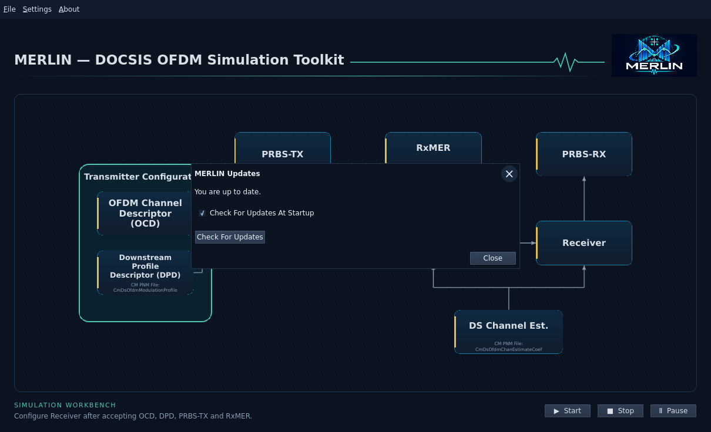

# Ubuntu 22.04 desktop installation

The current desktop installer targets **Ubuntu 22.04 x64 (amd64)**. It includes
the workbench, private Qt runtime, rounded desktop icon, user guides and all three
runnable example bundles, including channel 193 `multi-rxmer-2`.

## Get the installer

For packaged builds, open GitHub **Actions → Release** and download the successful
version-tag run's `merlin-assets-desktop-ubuntu22-amd64` artifact. **Master** runs
shared validation; optimized installers are produced by **Release**. Extract its ZIP to obtain the DEB
and `SHA256SUMS`. The workflow must first be committed and pushed; local workflow
files alone are not an executed GitHub build.

Stable version-tag releases also include the desktop DEB after all required
checks pass. Manual workflow artifacts are not stable published releases.

In the extracted artifact directory, verify the checksum and install:

```bash
sha256sum --check SHA256SUMS
sudo apt install ./merlin_0.1.0_ubuntu22.04_amd64.deb
```

Use the version actually downloaded. Start **MERLIN Simulation Workbench** from
the desktop application menu or run `merlin`. Run the application as your normal
user. The initial install may need network access to obtain Ubuntu dependencies;
viewing examples and running simulations work offline after setup. Python, Rust
and a separately installed Qt SDK are not application prerequisites.

**File → Open** starts in the packaged examples directory. Open one of the
bundle's `workbench.merlin.json` files. Save your edited WB to a writable personal
folder; packaged examples are read-only system resources.

## Update notification

MERLIN checks once in the background shortly after startup. A green **Update**
chip appears at the right of the **File | Settings | About** menu row when a
newer stable Ubuntu 22.04 amd64 desktop release is available. Click **Update**
to start downloading and verifying it. Ubuntu asks for administrator approval;
after installation MERLIN restarts automatically as your normal desktop user.
You do not need to download a DEB manually or click Update a second time.

Accepted workbench settings and embedded inputs are saved in a private recovery
WB before updating and restored after restart. Unapplied editor changes and
simulation results are not restored. The recovery file is
`$XDG_STATE_HOME/merlin/update-recovery/workbench.merlin.json`, normally under
`~/.local/state/`. It remains available to open manually if restart fails.
Save may ask for a destination after restart. Updating is disabled during a simulation. Source builds show update information
but cannot install system packages.

**About → Check For Updates…** or `merlin --check-updates` opens the separate
status/preferences dialog. It offers **Check For Updates**, **Update** and
**Check For Updates At Startup**. X and Close dismiss the status dialog while
installation continues; the main app stays open until installation completes.
Failed downloads, verification or canceled authentication keep MERLIN open. If
APT reports a partial failure, repair the installed package before retrying;
there is no automatic rollback.

Older MERLIN builds with the browser-only update flow need one manual upgrade
to a version containing this feature. Subsequent upgrades use the Update chip.

Only published stable releases trigger the indicator. A newer development
artifact in GitHub Actions does not. Offline or failed checks leave the
workbench usable; retry later from the dialog. The startup preference is stored
under `$XDG_CONFIG_HOME/merlin/preferences.json`, normally
`~/.config/merlin/preferences.json`, independently of WB files. Only public
release metadata is requested; no PNM files or simulation results are uploaded.



## Remove

```bash
sudo apt remove merlin
```

Your saved WBs and application preference remain in your own directories.
The standalone `merlin-ofdm` CLI package is a separate installation.

The build records installer bytes, installed file footprint and declared Ubuntu
prerequisites separately. Local package extraction/startup checks and hosted
install/reinstall/remove tests are distinct validation steps; consult the
[desktop delivery design](../../development/features/ubuntu-desktop/design.md)
for the actual recorded evidence.
