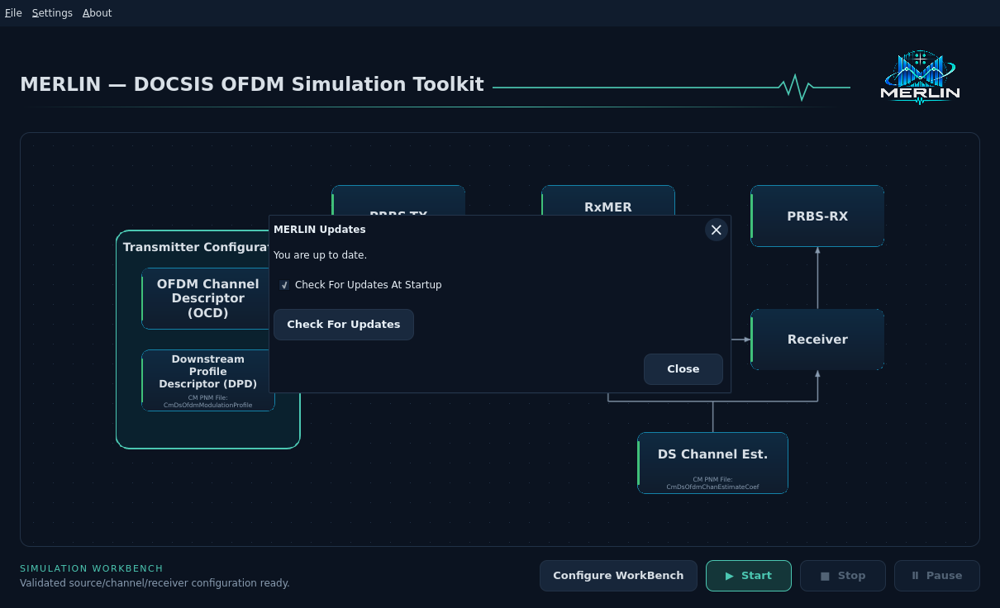

# Ubuntu 22.04+ desktop installation

The current desktop installer targets **Ubuntu 22.04+ x64 (amd64)**. It includes
the workbench, private Qt runtime, rounded desktop icon, user guides and all three
runnable example bundles, including channel 193 `multi-rxmer-2`.

## Get the installer

Download the **desktop DEB** and `SHA256SUMS` from the matching GitHub release.
Canonical filenames are `merlin-desktop_VERSION_ubuntu22.04_amd64.deb`.
The command-line DEB and portable CLI archive are separate downloads; neither is
needed to run the desktop application. Older releases such as 0.1.4 use
`merlin_VERSION_ubuntu22.04_amd64.deb`; use the filename actually downloaded.

Release workflow artifacts are another source for tested packages: extract the
`merlin-assets-desktop-ubuntu22-amd64` ZIP first. Manual workflow artifacts are
not stable published releases and do not trigger update notification.

## Install or upgrade with APT

Open a terminal in the folder containing the downloaded DEB and `SHA256SUMS`.
For example, if both are in Downloads:

```bash
cd ~/Downloads
ls -1 -- *.deb
sha256sum --ignore-missing --check SHA256SUMS
```

Use this generic local-package command, replacing **PACKAGE.deb** with the exact
desktop DEB filename listed above:

```bash
sudo apt install ./PACKAGE.deb
```

Keep the **`./`** prefix: it tells APT to install a file from the current folder.
An absolute path, such as `/home/USER/Downloads/PACKAGE.deb`, also works. Quote
paths containing spaces. Use the same command to upgrade to a newer downloaded
DEB; APT installs the required dependencies.

If APT reports **Unable to locate package**, check that the command includes
`./`. If it reports a missing or unsupported file, check the current directory
and exact filename with `pwd` and `ls -1 -- *.deb`. Do not copy a version number
from an older guide or pass the downloaded ZIP directly to APT.

Start **MERLIN Simulation Workbench** from
the desktop application menu or run `merlin`. Run the application as your normal
user. The initial install may need network access to obtain Ubuntu dependencies;
viewing examples and running simulations work offline after setup. Python, Rust
and a separately installed Qt SDK are not application prerequisites.

**File → Open** starts in the packaged examples directory. Open one of the
bundle's `workbench.merlin.json` files. Save your edited WB to a writable personal
folder; packaged examples are read-only system resources.

## Update notification

MERLIN checks once in the background shortly after startup. A green **Update**
chip appears at the right of the **File | Settings | About** menu row when a
newer stable Ubuntu 22.04+ amd64 desktop release is available. Click **Update**
to start downloading and verifying it. Ubuntu asks for administrator approval;
after installation MERLIN restarts automatically as your normal desktop user.
You do not need to download a DEB manually or click Update a second time.

Accepted downstream and upstream projects are saved together in a private
recovery bundle before installation starts. Restart restores both projects,
their independent Save destinations and unsaved-change flags, the selected tab
and theme. Blank upstream and incomplete downstream editor state are supported.
Unapplied drafts and simulation results are not restored. Recovery is separate
from normal File → Save, which still saves only the active direction.

The private bundle is
`$XDG_STATE_HOME/merlin/update-recovery/workbench.merlin.json`, normally under
`~/.local/state/`. Keep it if restart fails; restart MERLIN with `--restore-update`
to retry recovery. It is not a normal project file for File → Open. A rejected
bundle leaves the current projects unchanged and shows the failure. Earlier
single-downstream recovery files remain supported; their unavailable Save path
is left unset and their downstream project remains marked unsaved.

Updating waits for successful recovery writing and is disabled during a
simulation or pending file operation. Source builds show update information
but cannot install system packages. Native source-build restart testing does
not establish the installed APT/authentication lifecycle.

**About → About MERLIN → Check For Updates** or `merlin --check-updates` opens the separate
status/preferences dialog. It offers **Check For Updates**, **Update** and
**Check For Updates At Startup**. X and Close dismiss the status dialog while
installation continues; the main app stays open until installation completes.
Failed downloads, verification or canceled authentication keep MERLIN open. If
APT reports a partial failure, repair the installed package before retrying;
there is no automatic rollback.

Older MERLIN builds with the browser-only update flow need one manual upgrade
to a version containing this feature. Subsequent upgrades use the Update chip.

Only published stable releases trigger the indicator. A newer development
artifact in GitHub Actions does not. Offline or failed checks leave the
workbench usable; retry later from the dialog. The startup preference is stored
under `$XDG_CONFIG_HOME/merlin/preferences.json`, normally
`~/.config/merlin/preferences.json`, independently of WB files. Only public
release metadata is requested; no PNM files or simulation results are uploaded.



## Remove

```bash
sudo apt remove merlin
```

Your saved WBs and application preference remain in your own directories.
The standalone `merlin-ofdm` CLI package is a separate installation.

The build records installer bytes, installed file footprint and declared Ubuntu
prerequisites separately. Local package extraction/startup checks and hosted
install/reinstall/remove tests are distinct validation steps; consult the
[desktop delivery design](../../development/features/ubuntu-desktop/design.md)
for the actual recorded evidence.

## Ubuntu 22.04+ compatibility

Ubuntu 22.04+ means the x64 LTS target family, with explicit release checks on
22.04, 24.04 and 26.04. It is not a promise for every future Ubuntu release.
The `ubuntu22.04` asset name identifies the build baseline and remains unchanged.
The release-only `ubuntu-compatibility` matrix downloads the original 22.04
wheel and desktop DEB, verifies checksums, runs the Python single-capture example
in a clean CPython 3.10 environment, and exercises desktop install/reinstall/
removal. No replacement packages are built on newer hosts. Both jobs must pass
before publication. The newly added 24.04/26.04 installed checks are pending
hosted execution; configuration alone is not runtime evidence.
