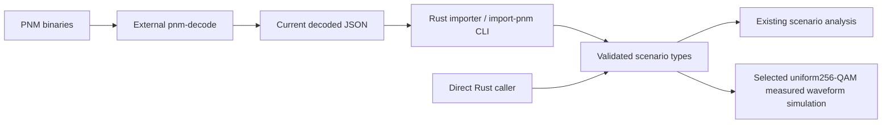

# PNM measurement inputs

Ideal/reference simulation needs transmission settings, not PNM captures.
Measurement-driven operation accepts current `pnm-decode` JSON through an importer for three
capture types: downstream RxMER, downstream channel estimation and the applied
downstream modulation profile. Direct Rust callers will use the same typed
scenario model without a decoder subprocess.

CLI scenario inputs use this repository's own schema. The
[import-pnm command](../impairments/pnm-import.md) converts decoded captures;
[impaired channel requests](../impairments/experiments.md) select an imported
frame/profile/response explicitly. Temporal/profile expansion remains MODEL-06.
Formal upstream schema/version compatibility is deferred in INPUT-02.

The [single-channel demo](../../../examples/measurements/single-channel/README.md)
provides all three decoder outputs and reproducible synthetic RxMER variants,
including the [LTE downlink ingress approximation](lte-ingress.md).
The sanitized modulation_profile.bin is also tracked for the Qt DPD importer;
other original binary copies stay in ignored local development storage. Each source
has a separate timestamp and provenance; the demo does not establish simultaneous
conditions. Imported measurements must preserve grids, nulls and source identity,
and use an explicit association policy rather than rewriting mismatched headers.

Fixture preparation owns only offline test-data generation. It does not parse PNM
binaries, expand profiles, simulate impairments or duplicate a production importer.
The Rust example uses deterministic dB reductions or the shared Rust LTE-inspired
linear-power model and preserves the decoder's document shape. Its precheck rejects
identity/grid/coverage mismatches without changing headers. No extra thermal floor
is added; derived RxMER represents the total residual to apply once later. Review
the demo's provenance before using these inputs as evidence.

The Qt [DPD profile-file dialog](modulation-profile.md) additionally accepts the
binary modulation-profile capture directly through a pinned in-process Rust
decoder. The CLI three-capture importer continues to consume decoded JSON.

The native [RxMER Designer](rxmer-designer.md) creates clearly labeled designed
copies or synthetic flat sequences, with per-effect capture scopes and a shared
original/designed preview. Both RxMER charts shade the profile-derived PLC region.
