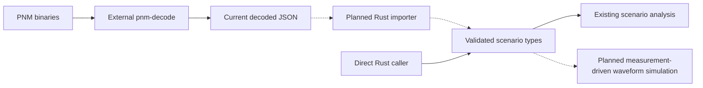

# PNM measurement inputs

Ideal/reference simulation needs transmission settings, not PNM captures.
Measurement-driven operation will accept current `pnm-decode` JSON for three
capture types: downstream RxMER, downstream channel estimation and the applied
downstream modulation profile. Direct Rust callers will use the same typed
scenario model without a decoder subprocess.

Solid arrows show available paths; dashed arrows are pending. Today, CLI scenario
inputs use this repository's own schema. Decoded JSON fixtures are not directly
accepted by the CLI. INPUT-01 tracks the importer; MODEL-06 tracks waveform
integration. Formal upstream schema/version compatibility is deferred in INPUT-02.

The [single-channel demo](../../../examples/measurements/single-channel/README.md)
provides all three decoder outputs and reproducible synthetic RxMER variants,
including the [LTE downlink ingress approximation](lte-ingress.md).
Its original binary copies stay in ignored local development storage. Each source
has a separate timestamp and provenance; the demo does not establish simultaneous
conditions. Imported measurements must preserve grids, nulls and source identity,
and use an explicit association policy rather than rewriting mismatched headers.

Fixture preparation owns only offline test-data generation. It does not parse PNM
binaries, expand profiles, simulate impairments or duplicate a production importer.
The Rust example uses deterministic dB reductions or the shared Rust LTE-inspired
linear-power model and preserves the decoder's document shape. Its precheck rejects
identity/grid/coverage mismatches without changing headers. No extra thermal floor
is added; derived RxMER represents the total residual to apply once later. Review
the demo's provenance before using these inputs as evidence.
