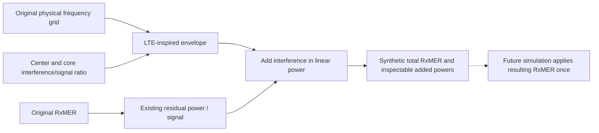

# LTE downlink ingress approximation

This Rust model prepares synthetic RxMER from existing decoded readings. It adds
interference at a normalized, equalized residual-error reference plane. It does
not generate LTE I/Q or inject noise into the waveform stepper.

## Geometry and assumptions

The demo uses a10MHz envelope centered at737.5MHz in LTE Band12. Nominal edges
are732.5–742.5MHz. A flat9MHz core spans733–742MHz, with500kHz cosine power
shoulders on either side. Core interference/signal power is−30dB per DOCSIS
carrier. This is neither total LTE power nor an absolute dBm/dBmV measurement.
The API accepts other core powers and centers only when the full10MHz envelope
fits inside Band12 and the measured carrier-center range.

Band limits and50 resource blocks for10MHz come from
[ETSI TS136104 V17.5.0](https://www.etsi.org/deliver/etsi_ts/136100_136199/136104/17.05.00_60/ts_136104v170500p.pdf),
section5.5 table5.5-1 and section5.6 table5.6-1. The9MHz core represents50 blocks
at180kHz each. **Flat loading and cosine shoulders are engineering assumptions,
not an LTE emission mask.** This approximation ignores LTE DC/resource structure,
traffic scheduling, time correlation, sidelobes beyond the envelope and receiver
filtering. Fixed10MHz support does not establish general LTE waveform conformance.

## Power combination and noise policy

For original MER \(M_k\), carrier frequency \(f_k\), LTE center \(f_c\) and core
interference/signal ratio \(A\) in dB, normalize each desired carrier to unit power:

\[
n_k=10^{-M_k/10},\quad i_k=10^{A/10}w(|f_k-f_c|),\quad
M'_k=-10\log_{10}(n_k+i_k).
\]

The power envelope is

\[
w(d)=\begin{cases}
1,&d\le4.5\times10^6\ \mathrm{Hz},\\
\tfrac12[1+\cos(\pi(d-4.5\times10^6)/(0.5\times10^6))],
&4.5\times10^6<d<5\times10^6\ \mathrm{Hz},\\
0,&d\ge5\times10^6\ \mathrm{Hz}.
\end{cases}
\]

This samples the envelope at carrier centers; it does not integrate calibrated
RF PSD through a receiver filter. An original30dB MER with−30dB core I/S gives
26.9897dB; an original40dB MER gives29.5861dB. Degradation is not fixed at12dB.

The original MER already represents total residual-error power. **No separate
thermal/system floor is added.** A future noiseless waveform experiment applies
the resulting RxMER-derived total once. Do not separately inject the original
MER, this LTE term or thermal noise again. An independent thermal model would
need an explicit noise budget and reference plane; it is not enabled here.
RxMER specifies error power, not its time distribution. Gaussian noise generation
would be an additional modeling assumption, not reconstruction of an LTE signal.

## Alignment, ownership and outputs

Carrier frequencies follow
\(f_k=f_{\mathrm{zero}}+(i_{\mathrm{first}}+k)\Delta f\).
Before writing variants, the fixture generator checks equal MAC, channel, zero
frequency, first index, spacing, I/Q count and each profile's run-length coverage.
It rejects mismatches without rewriting headers or interpolating. Run-length
coverage checking is not full profile semantic validation. Capture times remain
separate and are reported; matching frequencies do not establish simultaneity.

`signal_processing::noise::lte_ingress` owns the numerical model. Its public
`apply` operation borrows immutable input and returns synthetic MER and linear
added powers for inspection. It has no RNG, files or global state. Null readings
remain null; unaffected readings remain exact. Invalid input returns typed errors.
The example owns decoded-JSON adaptation and file I/O.

See the [demo and regeneration instructions](../../../examples/measurements/single-channel/README.md).
The [model sidecar](../../../examples/measurements/single-channel/lte-ingress-model.json)
records settings, alignment and the single-application policy without changing
the decoder JSON shape. INPUT-01 and MODEL-06 remain open: these are prepared
fixtures, not an implemented simulation importer or measurement-driven waveform.
