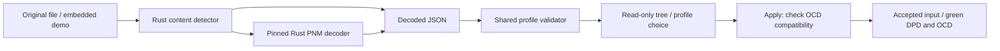
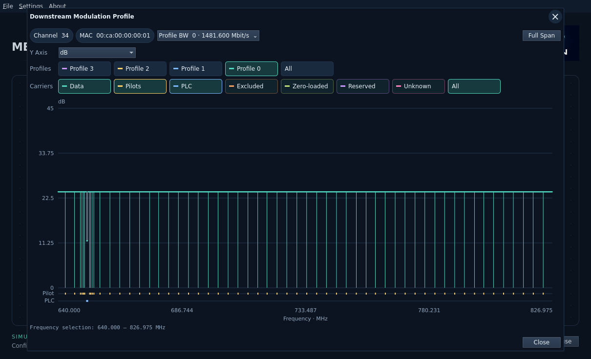
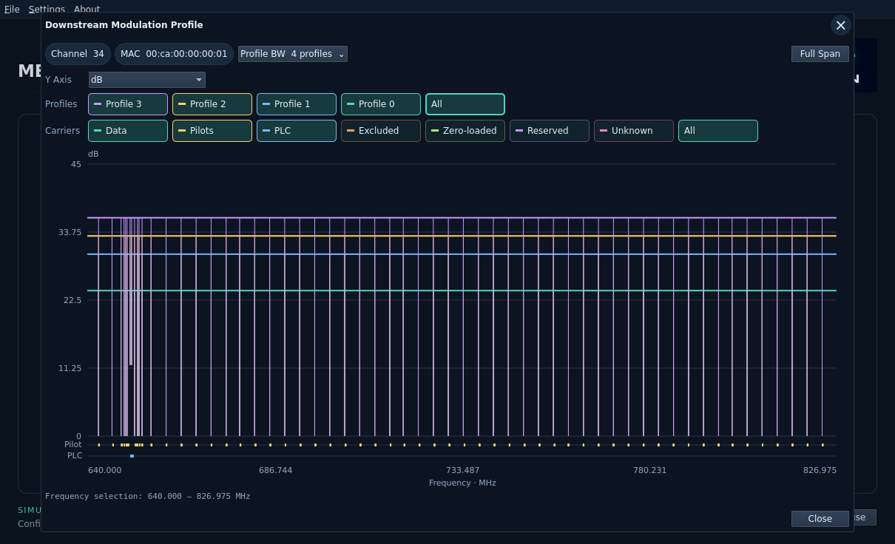
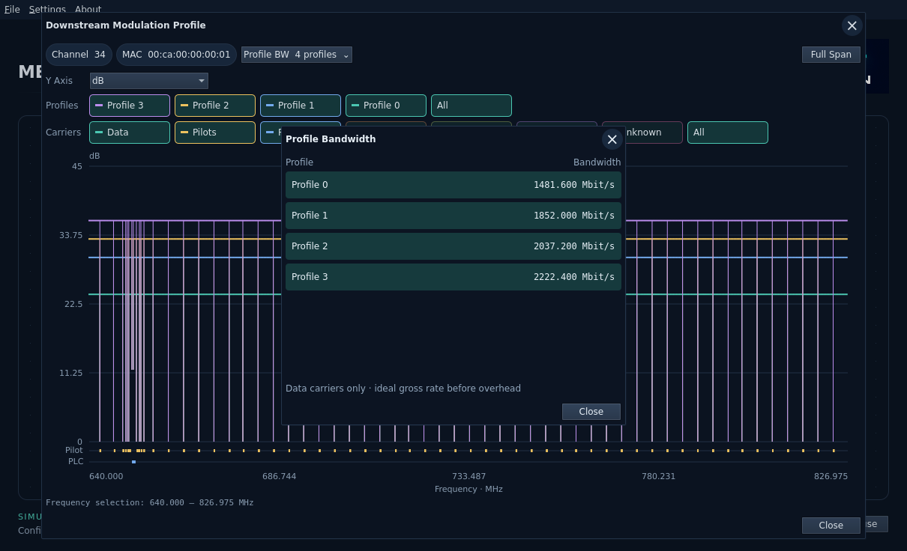
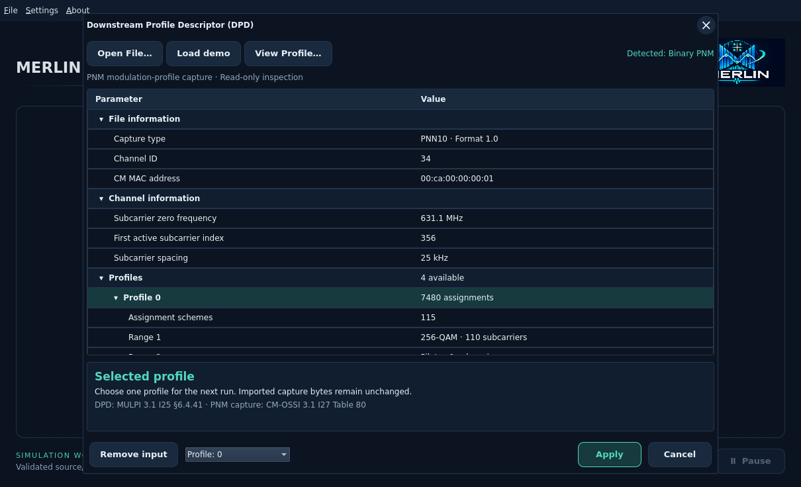

# Downstream profile capture input

The Qt **Downstream Profile Descriptor (DPD)** dialog imports a downstream OFDM
modulation-profile PNM capture or compatible `pnm-decode 0.3.6` JSON. It does not
parse raw DPD MAC messages. The names come from MULPI 3.1 I25 §6.4.41 (DPD) and
CM-OSSI 3.1 I27 §D.2.14.4.1, Table 80 (capture).

Choose **Open File** or **Load demo**, inspect the tree, choose a profile, then
Apply. Open File uses the OS-native GTK picker on Ubuntu; cancellation preserves
the draft, and unavailable integration reports an error without a Qt fallback.
Loading alone does not change the accepted selection. Cancel/Escape
preserves it. Remove input is also staged until Apply. Captures stay unchanged;
this dialog does not export modified captures or start a run. Settings and inputs
are included in saved workbench JSON; viewing and zoom are temporary.

Use **View Profile…** to inspect the capture with the PNM Viewer layout.
Channel and MAC chips identify the capture. Toggle individual **Profiles** to
overlay their colored traces; **All** enables every profile. These selections
never change the profile chosen for Apply. Carrier buttons filter Data, Pilots,
PLC, Excluded, Zero-loaded, Reserved and Unknown; unavailable roles are disabled.
Special carrier roles also appear in separate colored lanes beneath the plot.

**Y Axis** selects **dB** (ideal Shannon minimum MER) or **Bit loading**
(bits per symbol). The dB trace is a theoretical reference, not measured RxMER
or a receiver requirement. **Profile BW** opens per-profile gross data rates:
data-carrier bits multiplied by subcarrier spacing, before cyclic-prefix, FEC
and other overhead. It is not net payload throughput.

The horizontal axis preserves the capture's original frequency grid. Hover for
profile, frequency and value. Full-span views retain bounded extrema and break
lines across missing or filtered carriers; zoom resolves individual carriers.
Roles without loading remain markers, not invented zero-bit data.

Scroll over the plot to zoom around the pointer, drag horizontally to select a
range, and press **Full Span** to restore the entire profile. X and Close dismiss
the plot. Viewing never applies the draft or starts a simulation. The editor
does not display the capture filename; original names, bytes and hashes remain
stored with the workbench.

Content detection distinguishes binary PNM, JSON text (optional initial UTF-8 BOM),
unsupported text/binary and empty inputs. The filename extension is only a picker
hint. ASCII text is not automatically a valid profile; JSON syntax, capture type,
format, counts, coordinates and assignment codes must all validate.

Supported captures are type 10, file format 1.0 and **range** schemes. Other capture
types, versions, skip schemes and contradictory JSON fields reject explicitly.
The decoder may recognize more formats than this importer accepts. A file is
limited to 16 MiB; expansion follows existing bounded core validation. The tree
shows at most 256 compact scheme rows for the selected profile and explicitly
labels truncation. It does not serialize expanded per-carrier arrays to QML.
Range numbers follow capture scheme order, not physical subcarrier indices.

The demo contains profile IDs 0–3, each with 7,480 assignments and 115 schemes.
Profile 0 is initially preferred. The input is a sanitized capture, not a generated
simulation result. Applying requires the capture's spacing and carrier span to
fit accepted OCD settings. Editing channel spacing/bandwidth in the UI remains
pending; incompatible captures stay in the editor with a diagnostic.

All four demo profiles can be inspected and selected as input. Receiver
configuration defaults to running all captured data profiles separately as
bootstrap Profile A experiments; [Profile Performance](../receiver-profile-performance.md)
retains their original captured IDs. Simulation support
is checked when preparing the run; successfully importing a capture does not
guarantee its assignments fit the supported transmit/receive configuration.

Input provenance records the SHA-256 and length of the **original selected file**.
For binary input, the shared JSON importer also records the separately decoded
JSON provenance; these hashes identify different bytes. Neither replaces the
other. File headers do not prove a JSON producer version. The binary decoder is
fetched at a fixed Git revision during development and linked in process; the
installed application needs no viewer checkout, network, Python or subprocess.

See [workbench controls](../workbench.md), [CLI JSON import](../impairments/pnm-import.md)
and [demo provenance](../../../examples/measurements/single-channel/provenance.json).
