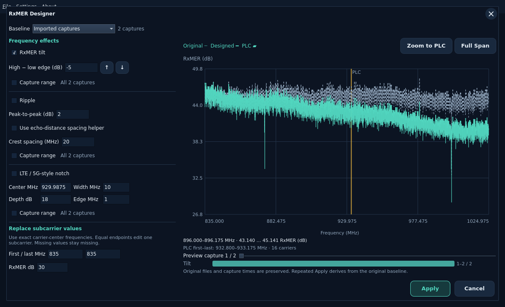
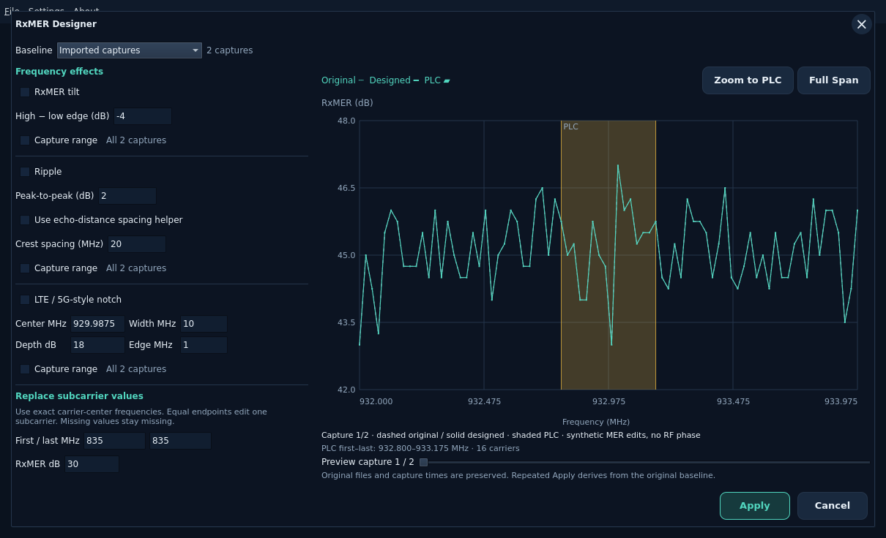
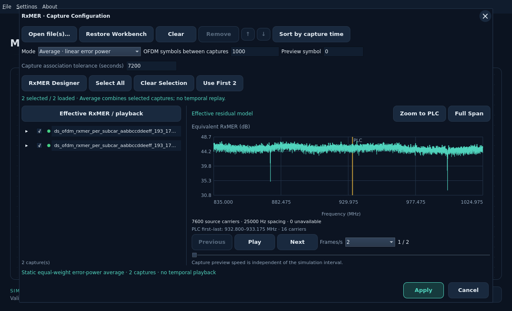

# RxMER Designer

Open **RxMER → RxMER Designer** after applying a modulation profile. Start from
loaded captures or choose **New flat sequence**. The flat sequence uses the exact
profile grid and keeps excluded carriers unavailable. Its profile epoch is only
an association anchor; it is not a measured acquisition time.

Enable the effects you need. The tilt text box remains editable; its **↑ / ↓**
buttons or the field’s Up/Down keys adjust the current value by exactly **1 dB**.
Fractional typed values remain supported. Steps beyond ±60 dB or from invalid
text are disabled.

The preview overlays the original dashed curve and
the designed solid curve on the same RxMER axis. A single shaded **PLC** region
runs from the first to the last PLC carrier in the accepted modulation profile.
The main RxMER chart uses the same region, clipped when zoomed. At full span,
a narrow PLC may cover only one or two pixels. Press **Zoom to PLC** in either
view to frame it with nearby carriers. Scroll over the chart to zoom around the
pointer, drag horizontally to select a range, or focus the chart and use **+ / −**.
**Full Span** or **Home** restores the whole frequency band. The Designer keeps
zoom when changing capture or effect controls. The first/last PLC frequency
readout is below the chart; shading and border lines retain their true positions.

No PLC region is guessed from the RxMER shape; a missing or incompatible profile has no overlay.

| Control | Effect |
| --- | --- |
| RxMER tilt | Signed high-edge minus low-edge change in dB, anchored at the low edge. |
| Ripple | A cosine-shaped MER change with independent peak-to-peak depth and crest spacing. |
| Echo-distance helper | Suggests crest spacing from distance and cable velocity factor under a round-trip cavity assumption. It does not determine depth or phase. |
| LTE / 5G-style notch | Reduces MER within a center/width band, with flat interior and optional raised-cosine edges. It does not generate a cellular RF waveform. |
| Replace subcarrier values | Sets a final MER value at one exact carrier-center frequency or an inclusive frequency range. Missing samples remain missing. |

Each effect has its own **Capture range**. Leave it unchecked for all captures.
Check it for one-based inclusive first/last capture numbers. Equal numbers select
one capture. For example, **10 to 20** of 50 affects exactly 11 captures. These
capture numbers are separate from subcarrier frequencies. Move **Preview capture**
to inspect the sequence and use the timeline to see where each effect applies.

Effects apply in order: tilt, ripple, notch, then listed value replacements.
The supported limits are 256 captures, 4 million values, 32 value ranges, ±60 dB tilt,
0–60 dB ripple/notch depth and final MER −30 through 120 dB. Invalid combinations
reject without clipping or changing original input files. Hover or focus known
recipe errors for help; click or press Enter/F1 to open the offline FAQ.

**Apply** builds the designed collection on a cancellable Rust worker and stages
it in Capture Configuration. Progress counts completed captures. Then select the
captures and playback mode, check the workbench capacity guidance, and press the
parent **Apply** to accept them for simulation. A generated sequence defaults to
Replay · hold; its interval may need reducing to fit the configured observation
window. The Designer never bypasses association, grid or playback validation.

**Cancel** or X discards the Designer operation. Parent Cancel preserves the
previously accepted measurements. Workbench Save embeds designed envelopes,
original capture bytes or synthetic templates, and the recipe. These are
MERLIN-specific JSON records, not new PNM binary captures. Reopening a coherent
designed collection restores its recipe and original baselines, so repeated Apply
does not compound the edits. Reordered or mixed recipes start a fresh recipe
against their retained baselines.

The distance helper uses `spacing = 299792458 × VF / (2 × distance_metres)` in Hz,
rounded to integer Hz. The round-trip assumption follows the echo-cavity discussion
in [CableLabs PNM Guidelines, pp78–80](https://account.cablelabs.com/server/alfresco/4f3782eb-a1d7-4398-bc21-6d12bb70f915#page=78).
Ripple depth depends on noise placement and cannot be inferred from spacing alone.
These controls edit an RxMER residual profile; the
[measurement channel](../channel-measurements.md) converts the resulting total
MER to residual error power once. They do not estimate a complex channel response.
