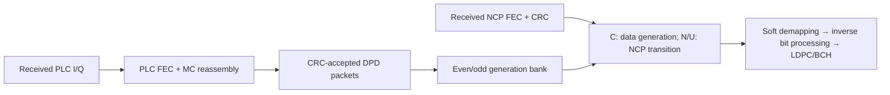

# Switching data and NCP profiles

The opt-in dynamic receiver selects data profiles0..15 using received NCP starts.
C chooses the even/odd DPD generation for that profile. N selects the NCP generation;
the preceding128 U bits announce when the NCP modulation changes. The ordinary
fixed receiver retains its existing strict rejection of these dynamic flags.

Each bank is tied to the initially acquired CMTS/channel and stable OCD geometry.
It retains at most two generations for each profile. An identical DPD repeat is
idempotent. A conflicting same-parity generation rejects rather than replacing a
profile which a pending word could still need; reacquire for further counter wrap.
NCP loading is positive uniform QPSK,16-QAM or64-QAM. OPT tagging and dynamic
shortened words are not included in this full-word path.

Data-profile changes begin at new codeword starts. The TX API requires an empty
source queue before changing its applied data profile. Previously transmitted
words can remain in the cell interleaver. The receiver retains their selected
loading across continuation spans and changes coding only at a subsequent start.
Receive sequence numbers, randomizers and time/frequency interleavers continue.
The bounded duration CLI runner still freezes its profile; this feature is exposed
through the streaming Rust API rather than a new CLI switch.

For NCP changes, deliver the new DPD before its activation symbol and schedule at
least128 source symbols of lead time. The MSB-first U pattern is
`BCB240898BAD833539ED0ABE946E3F85`, exactly as in PHY I20 §8.3.4.1, Table53.
U is zero outside that interval. The receiver predicts the next NCP modulation from
accepted U history before demapping the next field. Missing generations, an
unannounced N change or an omitted change after the complete pattern reject.

The live PLC owner must explicitly enable profile-update routing after initial
readiness. Future DPDs then enter its generation bank while the OCD gate stays
stable. Forward its accepted packet bytes into the dynamic payload receiver's
bank. Both admissions validate the received packet; no transmitter layout, word
ID or schedule becomes receiver input. Reset clears the PLC bank.

Tests recover an updated DPD through actual PLC coding/QAM/reassembly, and switch
payload/NCP profiles through actual cell transport at both spacings. A codeword
crosses the NCP transition and recovers with zero errors. Separate tests cover
pattern corruption, occupied slots, repeat admission and fixed-session rejection.
These are local simulation results, not external CMTS interoperability vectors.
