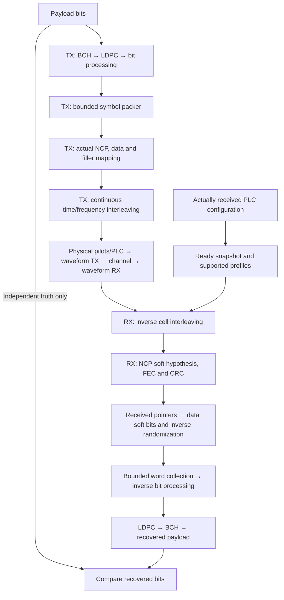

# Continuous payload and NCP transport

The fixed-profile TX/RX path now carries actual encoded payload and NCP through
cell interleaving and the [waveform](../waveform/README.md). Each subsystem has
one Rust owner; runners connect stages rather than reimplementing the math.

| Subsystem | Design guide |
| --- | --- |
| Applied uniform/mixed profiles | [Bit loading and coding](applied-profiles.md) |
| Packed-symbol signal assembly | [Assembly](assembly.md) |
| Continuous TX queue/interleaver/session | [Transmitter](transmitter.md) |
| Received configuration and support checks | [Configuration](configuration.md) |
| NCP hypotheses and accepted boundaries | [Control recovery](control.md) |
| Pending word and actual decoder results | [Collector](collector.md) |
| Source-order receive processing | [Decoder](decoder.md) |
| Physical-to-source RX stream | [Receiver](receiver.md) |
| Scientific result meanings | [Results](results.md) |
| Bounded stage inspection | [Test points](observations.md) |
| Actual sample-domain demonstration | [Reference experiment](reference-experiment.md) |

Current support is short8/9 concatenated coding, frozen ProfileA ID0 with
all ten uniform data orders or verified mixed loading, and uniform positive QPSK/16-QAM/64-QAM
NCP. Mixed and zero-loaded DPD positions are supported as described in the
applied-profile guide. Dynamic switching, other profile selectors, odd selection,
OPT tagging and unsupported data orders reject
explicitly. Z-marked unused data fields remain BPSK filler, distinct from a
zero-loaded position within an active codeword.

Streams retain state across calls and are independent of simulation duration.
They do not reset at one-second boundaries or codeword boundaries. The new
[channel stepper](../channel-runner/README.md) selects a configurable observation
duration, initially one second; the original bounded demonstration remains
shorter. Both use the separate [PRBS15 source/verifier](../simulation/prbs.md).
The [job/CLI wrapper](../channel-runner/cli.md) adds cancellation, source-window
metrics and partial results. Pilot-derived reception is now available; full blind acquisition remains later work.
See [architecture](../../architecture.md), [checklist](../../development/checklist.md)
and [source evidence](../../reference/payload-transport-evidence.md).

For explicit shortened words and received-boundary length discovery, see the
[QAM transport component guides](../qam-processing/README.md). General channel
PRBS/file jobs retain their established full-word EOF policy.
