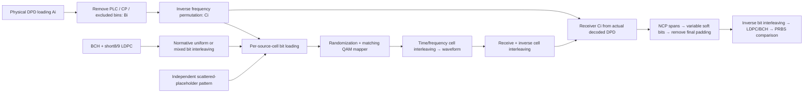

# Applied data profiles and mixed-modulation transport

The waveform path supports frozen ProfileA ID0 with uniform16/256-QAM or a
mixed profile using data bit counts0,4,6..14, including16K-QAM. Protected bins
remain governed by the physical map. Uniform higher-order modes still need their
own verified bit-interleaver rules and reject explicitly; they are not silently
processed as mixed profiles. Shortened codewords and dynamic profile activation
are separate unsupported modes.



PHY I20 section7.5.5.5.1, PDF125–127 defines the transmitted profile and requires
inverse frequency mapping before loading:

\[
C_i=P^{-1}(B_i).
\]

Time interleaving changes delay, not the frequency assignment. Scattered-pilot
placeholders remain independently phased through the existing reference pattern.
NCP positions still count all non-pilot data cells, including zero-loaded cells.

For non-shortened mixed codewords, section7.5.4.3.2 Tables27/28, PDF117 specifies
parity interleaving followed by24-column twisting. A16200-bit short word has675
rows. The twists are:

```text
0 0 0 0 0 0 0 1 1 1 2 2 2 3 7 9 9 9 10 10 10 10 10 11
```

Section7.5.5.2.2, PDF122–123 bypasses the uniform bit-to-cell demultiplexer for
mixed profiles. Successive cells take their declared number of bits, MSB first;
only the last incomplete cell is zero-padded. The receiver knows the full coded
length from its supported coding mode and discards only that final-cell padding
before the inverse permutation/LDPC decoder. Zero-loaded cells clock the BPSK
randomizer but transport no payload bits. Zeros are ignored when deciding whether
a profile is mixed; uniform256 plus zero-loaded bins still uses uniform256 rules.

The transmitter queues bounded encoded bits and assigns them while forming NCP
pointers; it does not precompute fixed-width labels for variable-width profiles.
`tx.payload.interleaved_bits` exposes that intermediate stream. The old fixed256
label test point remains for the unchanged legacy path. Actual cells carry no
TX word IDs into RX. The receiver obtains ProfileA loading from decoded PLC DPD,
not the transmitter's profile object; received NCP spans define word boundaries.
Soft data cells now carry a variable-length LLR vector, empty for zero loading.
Constellation pairs report their actual modulation order and omit zero-loaded
BPSK cells from the payload-QAM view.

For direct requests, `data_bit_loading` is an optional full physical-FFT array.
Measurement import fills it from the selected captured ProfileA and preserves
exact roles/coverage. Large range patterns must fit the existing descriptor
packet bounds; they fail explicitly if acquisition packets cannot represent them.
Omitting it retains the legacy uniform256 path.

Tests independently reconstruct all16200 mixed permutation indexes from the
published matrix/twists and parity arithmetic. Waveform tests at both spacings
cover uniform16, mixed16/256/16K and zero loading, reference/pilot-estimated RX,
actual FEC recovery, and modulation order matching the physical profile. Existing
uniform256 coding/transport tests remain in the full regression gate.
