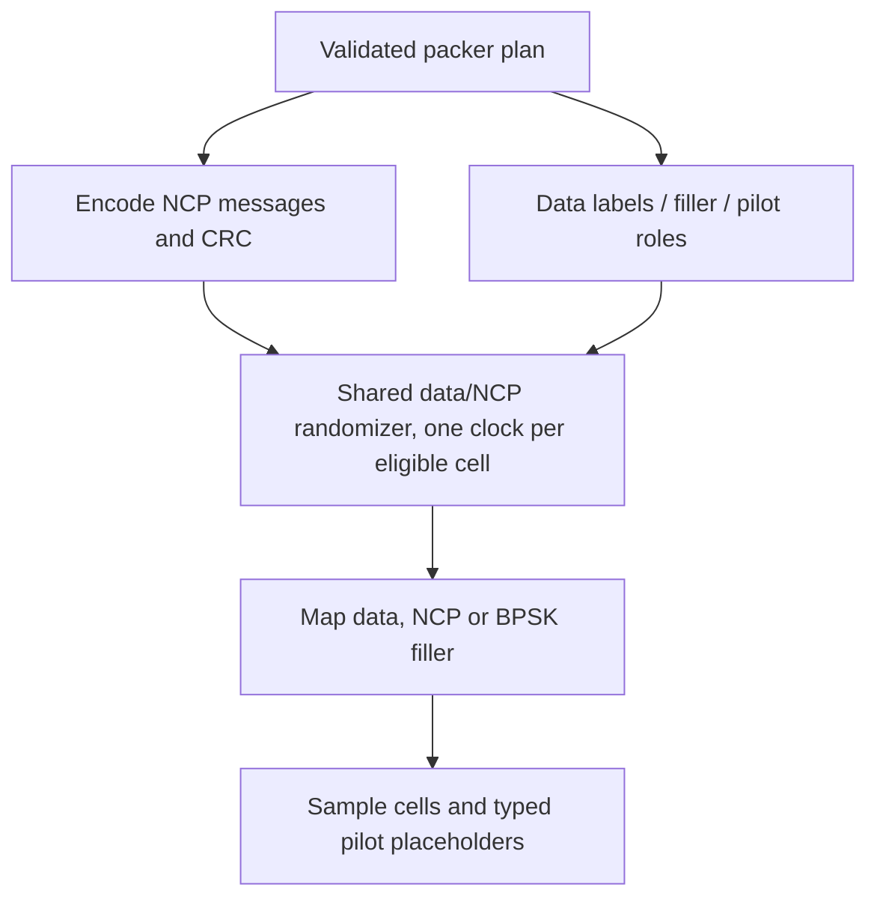

# TX: packed-symbol signal assembly

Assembly turns an existing bounded packer plan into actual transmitted cells.
It first encodes NCP messages, CRC and control FEC, validating the reserved
positions. Then it processes cells in increasing pre-interleaving order.

Data uses256-QAM, NCP uses its configured control order, and Z-marked filler uses
the specified BPSK sequence. Scattered-pilot placeholders do not clock the
randomizer. The existing randomizer owns all mask arithmetic; no duplicate LFSR
is added here. A candidate copy commits only after successful assembly, so a
malformed label or reservation cannot partially advance the stream.

Interleaver values distinguish `Sample`, `PilotPlaceholder` and an outer `None`
for unavailable history. They contain no codeword ID, cell offset or reserved
NCP marker. Those remain TX-only plan diagnostics; the receiver must discover
field length and codeword starts from received control signaling.
