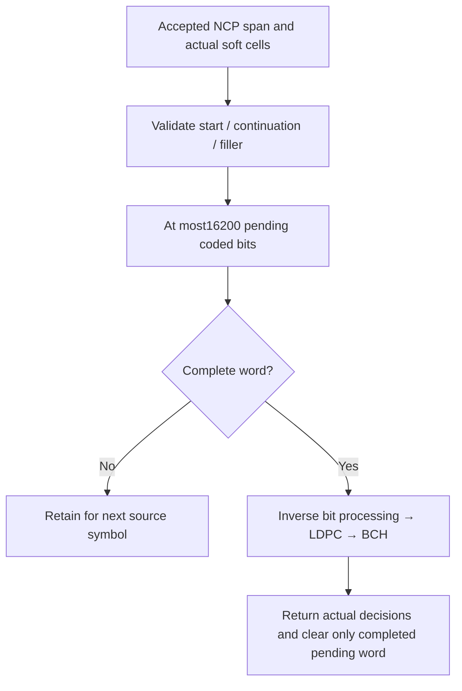

# RX: bounded cross-symbol word collection

The collector owns at most one pending short codeword. Accepted NCP spans tell
it whether cells start a ProfileA word, continue a previous one or carry unused
filler. It never derives a boundary from a TX codeword ID.

The legacy256-QAM path contributes8 bits/cell, using $16200/8=2025$ cells.
The applied-profile path collects variable-length soft cells until16200 coded
bits are present, discarding only documented final-cell padding. Zero-loaded
cells carry no payload bits. The selected uniform/mixed inverse permutation
produces LDPC input; see [applied profiles](applied-profiles.md).
LDPC then recovers14400 BCH-input bits; BCH recovers14232 payload bits.
No source truth participates in these decisions.

An orphan continuation, premature new start, filler inside an unfinished word,
unsupported profile or interval exceeding one word plus its final-cell padding
is rejected.
Pending data is not padded to manufacture a complete word. Successful word
completion returns its soft boundaries, actual LDPC iterations, LDPC/BCH flags
and corrected-bit count. Decoder flags and comparison against independent truth
remain separate measurements.
