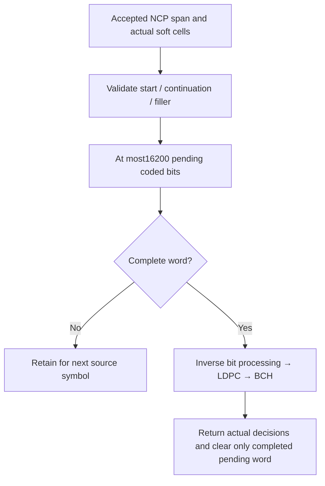

# RX: bounded cross-symbol word collection

The collector owns at most one pending short codeword. Accepted NCP spans tell
it whether cells start a ProfileA word, continue a previous one or carry unused
filler. It never derives a boundary from a TX codeword ID.

Each256-QAM data cell contributes8 coded bits, so a complete supported word uses
$16200/8=2025$ cells. The existing inverse bit permutation produces LDPC input.
LDPC then recovers14400 BCH-input bits; BCH recovers14232 payload bits.
No source truth participates in these decisions.

An orphan continuation, premature new start, filler inside an unfinished word,
unsupported profile or interval longer than the remaining word is rejected.
Pending data is not padded to manufacture a complete word. Successful word
completion returns its soft boundaries, actual LDPC iterations, LDPC/BCH flags
and corrected-bit count. Decoder flags and comparison against independent truth
remain separate measurements.
