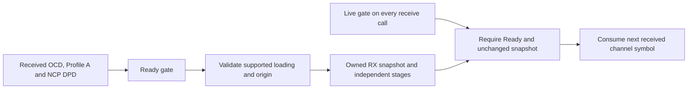

# RX: acquired configuration and supported scope

The receiver is constructed from the PLC readiness owner, not a transmitter
profile, packer plan or array of original bits. It keeps an immutable copy of the
accepted configuration and builds its own physical/pilot/interleaver association.

All effective data bins must use8 bits and the NCP map must use one positive
supported order throughout. Mixed/zero-loaded DPD assignments fail explicitly;
there is no substituted default. Channel/source identities, maps and independent
OCD/DPD counts are retained. Counts are not required to match each other, and
must not be confused with NCP C/N activation selectors.

A gate rejection prevents consumption of the next channel symbol. A valid repeat
can reopen the same gate without deleting the existing payload history. Retrying
is meaningful only if the caller retained the exact next received input; lost
samples require a new synchronized session. A different ready snapshot likewise
requires new payload state.

The reference starts a new payload session at an explicit128-symbol boundary
after PLC acquisition. Local stream index0 maps to that absolute origin. This
aligns existing randomizer resets without claiming acquisition of an arbitrary
already-running payload stream. Blind and dynamic activation behavior remain
outside this fixed-session implementation.
