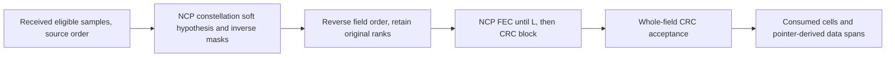

# RX: NCP hypotheses and boundary discovery

RX removes known scattered-pilot placeholders and traverses actual eligible
samples in increasing source order. A dedicated randomizer hypothesis soft-demaps
every eligible point under the acquired NCP constellation. The field decoder
reads those hypotheses from highest data-position rank downward.

Neither TX reservation length nor diagnostic codeword identities enter this path.
CRC acceptance determines the complete control field; only then are the remaining
data positions interpreted. The existing control codec owns parity, puncturing,
label ordering and CRC arithmetic. Its complete-field error contract is preserved:
failed fields expose soft hypotheses and a typed error, not partially accepted
messages or a fabricated payload boundary.

The fixed stream rejects C/N odd selection, U update signaling and tagging instead
of pretending to implement dynamic activation. The4K rolling start limit is
checked across accepted source symbols. Z marks unused data; NULL does not start
a new payload. See [NCP math](../ncp.md) for the independent control-code equations.
