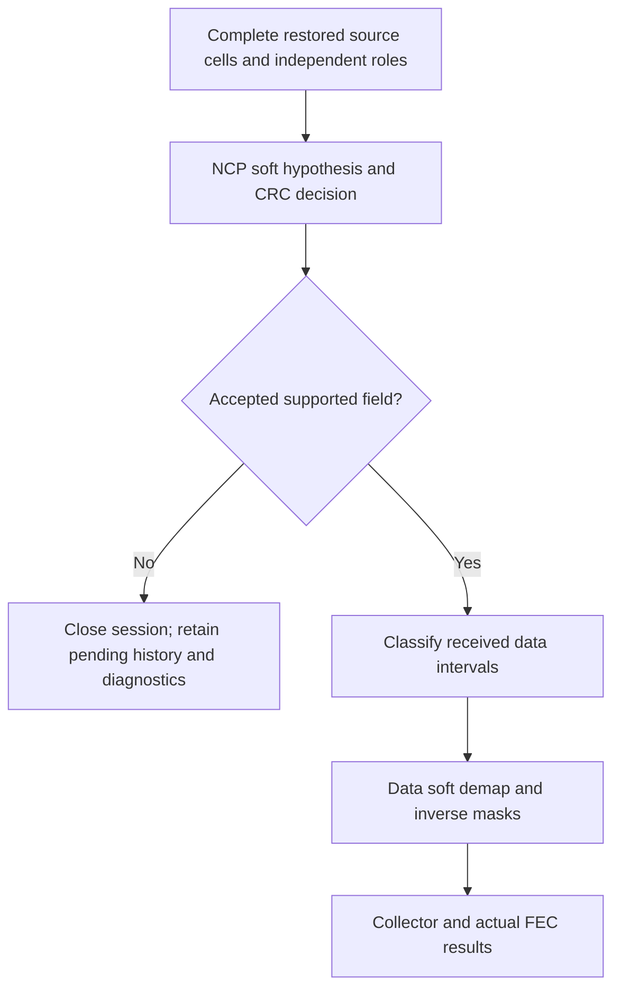

# RX: source-order payload decoder

The source decoder composes control recovery, the separate data hypothesis and
bounded collection. It preserves randomizer state across source symbols and
resets only at the specified128-symbol boundary, including inside a codeword.

Both hypotheses clock once for each eligible point and never clock a scattered
placeholder. The data hypothesis processes each actual payload cell using the acquired
source-rank bit loading; zero-loaded cells clock BPSK without payload bits. Filler
and NCP positions only advance its shared sequence. After each accepted symbol,
the two register states must agree. This prevents NCP placement from silently
changing future payload masks.

Bad API dimensions/sequence/work limits are rejected before processing. A control
or collection failure returns a terminal result containing the reason, available
soft/control diagnostics, pending count and any words already completed in that
call. It closes subsequent recovery until a new session is constructed. A
returned LDPC/BCH failure flag is an actual completed word outcome, not an API
exception and not proof of correct bits. Positive reference variance scales LLRs;
it does not inject noise.
