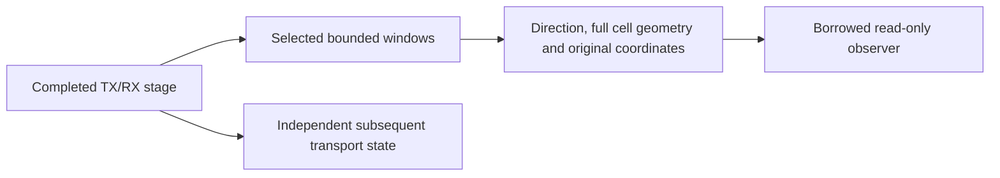

# Payload and NCP test points

Ten producers use the existing finite observation dispatcher. Each operates on
completed outputs, so observer failure or budget exhaustion cannot alter queued
words, randomizer clocks, inverse-interleaver history or decoded results.

| Direction | ID | Values |
| --- | --- | --- |
| TX | `tx.payload.ldpc` | Actual coded bits |
| TX | `tx.payload.labels` | Post-bit-processing256-QAM labels |
| TX | `tx.cells.mapped` | Source-order typed cells |
| TX | `tx.cells.interleaved` | Channel-order typed cells, retaining unavailable history |
| RX | `rx.cells.restored` | Actual inverse-interleaver output |
| RX | `rx.ncp.llrs` | NCP soft records with original data-position ranks |
| RX | `rx.ncp.accepted` | CRC-accepted messages; activation support is checked separately |
| RX | `rx.data.llrs` | Actual payload soft records after inverse masks |
| RX | `rx.bits.inverse` | Complete word's LDPC-input LLRs |
| RX | `rx.payload.bits` | Recovered BCH payload bits |

Cell metadata retains validated spacing/NI/depth, NCP modulation and absolute
session origin. Source and channel coordinates remain distinct. Enqueue-stage
time is deliberately unknown until placement; only its TX diagnostic word ID
is attached. RX word events use their own receive sequence. Source-domain cell
rank is not a direct physical frequency bin after time/frequency mixing.
Typed pilot placeholders remain distinct from outer `None` history even in
serialized selected windows. LLRs favor zero when positive.

Existing budgets still apply: up to32 selected stages,100000 events,65536 records
per event and1048576 total records. A soft-cell record contains its bounded2/4/6
NCP or8 data LLRs. Disabled, enabled, deliberately failed and exhausted callbacks
are tested against identical actual recovered payload, not merely event counts.
The original [waveform probes](../waveform/observations.md) remain available
alongside these cell/control/codec boundaries.
