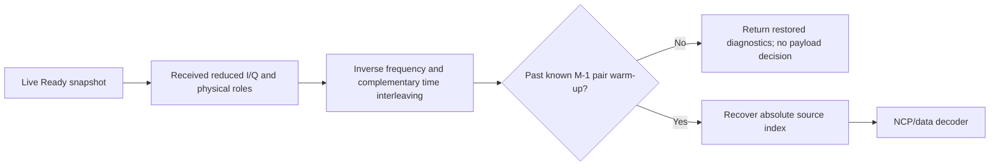

# RX: continuous physical-to-source reception

The received stream owns an inverse cell interleaver and source decoder. Every
call checks the live PLC gate, configuration snapshot, absolute channel sequence,
array bounds and physical pilot roles before advancing interleaver history.

For session origin $s_0$, local channel step $c$ and depth $M$, the recovered
source index is

$$
s=s_0+c-(M-1),\qquad c\ge M-1.
$$

Earlier periods are explicitly warm-up. TX replacement-rank diagnostics are not
used to make that decision; the receiver uses configured delay and actual samples.
Its source pilot roles come from an independently reconstructed reference.

Received results retain restored cells and the source decision. An incomplete
word remains pending until sufficient source cells arrive, including during TX
drain. The caller must preserve complete results before moving on. After a
post-interleaving processing failure, restart the session rather than replaying
consumed channel data. Nonideal resynchronization is not implemented here.
