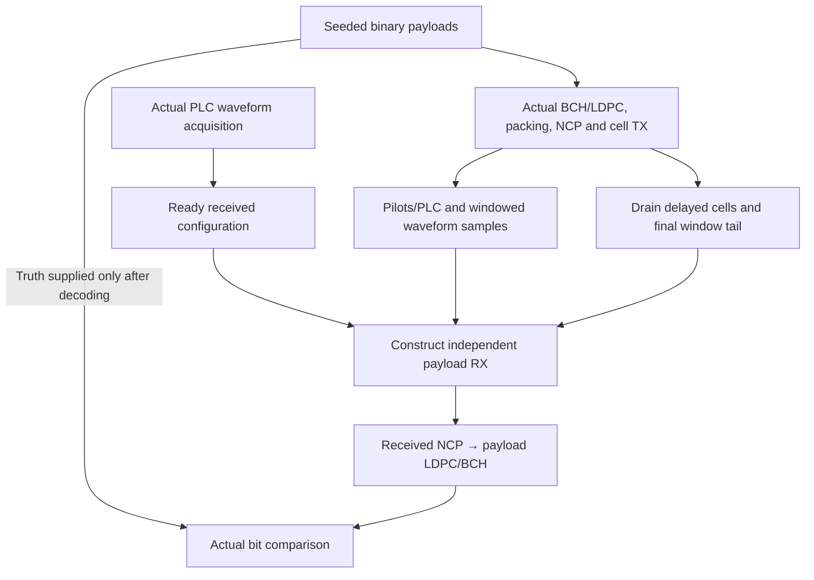

# Actual payload waveform experiment

Run the shared Rust verifier:

```bash
./scripts/cargo-local.sh run -p docsis-ofdm-fec --example payload_waveform --locked
```

The example first acquires actual OCD/ProfileA/NCP packets through PLC waveform
samples. Acquisition uses explicit known timing/layout and reference filler in
the unconfigured data plane. Once the received gate is Ready, a new synchronized
payload session starts at the next128-symbol boundary.



At both spacings it sends four scheduled payloads over160 source symbols at
maximum interleaver depth, splits RX sample blocks into137-sample chunks, crosses
the128-symbol reset and retains words completed during drain. The JSON contains
real payload bit errors, independent decoder flags, LDPC iterations, BCH correction
counts, accepted NCP iterations, pending bits, warm-up/drain counts and waveform/
PLC comparisons. It does not estimate throughput from a guessed bit rate.

The verifier permits1–512 source symbols and at most16 scheduled payloads.
Acquisition is bounded to eight PLC frames. An interval too short to place/recover
all scheduled words fails explicitly. Samples and scientific stage histories are
streamed; no entire waveform is retained. Output summaries remain bounded.
The demonstration uses a synthetic24MHz active envelope with explicit pilot
positions and a unity channel. A positive soft-reference variance generates
finite LLRs but adds no channel noise.

This is a reproducible short proof of production transport modules, not the
configurable-duration job runner. Streams themselves use continuous64-bit symbol
identities without per-second resets; a later runner will choose duration,
initially one second, with cancellation, progress and partial-result accounting.
The source remains deterministic seeded data; it is not labeled PRBS.
