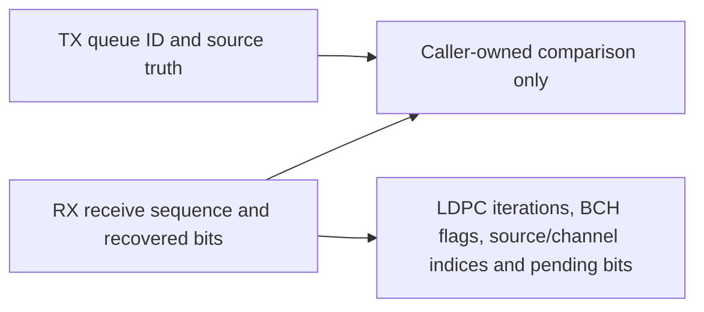

# Payload result meanings

TX results expose coding bits, labels, plan diagnostics and the actual mapped
cell stream. RX results expose received/restored cells, control hypotheses,
accepted NCP, data soft cells and actual recovered words. These have distinct
lifetimes and identities.

A receive sequence is assigned by the receiver; it is not a copied TX queue ID.
The supported ordered noiseless experiment associates returned words with its
original payload list outside the decoder. First/last source indices describe
which source symbols contributed a word, while channel indices include
interleaver delay. A codeword can straddle the randomizer reset and still retain
one receive identity.

Control/data soft-cell records carry their original eligible data-position rank.
Control hypotheses are stored in high-to-low field order; data records are
ascending and include only payload positions. Pending bit counts identify
incomplete work and do not count as decoded payload. A terminal diagnostic does
not erase caller-owned completed results or silently clear pending history.
