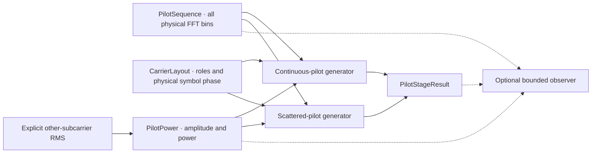

# Pilot signals and test points

Continuous and scattered pilot generators produce physical-bin BPSK values for
both 25 kHz and 50 kHz spacing. They reuse the validated carrier layout and shared
constellation mapper. Each stage has its own Rust module and typed output.

Run the bounded example from the repository root:

```bash
./scripts/cargo-local.sh run -p docsis-ofdm-fec --example pilot_signals --locked
```

The example emits JSON containing the completed pilot result, selected probe
windows and dispatch counters. It uses a synthetic 24 MHz layout with explicit
additional continuous-pilot positions, physical symbol zero and reference RMS1.
It does not simulate a complete OFDM waveform.



## Sequence and physical positions

PHY3.1 I20 §7.5.15.3–4, Figure84 (PDF171), defines a shared 13-bit sequence with
polynomial

$$
p(x)=x^{13}+x^{12}+x^{11}+x^8+1.
$$

The implementation follows the diagram's Galois register orientation. Bit0 is
the rightmost/output stage, initialized with all13 bits set:

$$
s_0=2^{13}-1,\qquad w_k=s_k\mathbin{\&}1,
$$

$$
s_{k+1}=(s_k\gg1)\oplus
\begin{cases}
\mathtt{0x1013},&w_k=1,\\
0,&w_k=0.
\end{cases}
$$

Generate a bit for **every physical FFT bin**, including PLC, excluded and
nonpilot bins. Do not advance only at selected pilots. Each symbol uses the same
sequence starting at bin0; the physical scattered-pilot positions change with
symbol phase. `PilotSequence` stores one immutable 4096/8192-bin sequence and
reuses it. Published checks are $w_{1000}=0$ and $w_{2999}=1$.

`generate_continuous` selects continuous-pilot roles. `generate_scattered` selects
scattered roles for the requested physical symbol index, modulo the128-symbol
pattern. Layout role priority prevents signals from replacing PLC, excluded or
continuous-pilot positions. Returned records are ordered by physical bin and
contain `bin`, `sequence_bit` and `iq`.

## Amplitude and power

The bit mapping is $0\mapsto+1+j0$, $1\mapsto-1+j0$. With caller-supplied
other-subcarrier RMS amplitude $A_{\mathrm{ref}}$:

$$
X_k=2A_{\mathrm{ref}}(1-2w_k)+j0,
\qquad P_{\mathrm{ref}}=A_{\mathrm{ref}}^2,
\qquad P_{\mathrm{pilot}}=4P_{\mathrm{ref}}.
$$

The relative boost is

$$
10\log_{10}\!\left(\frac{P_{\mathrm{pilot}}}{P_{\mathrm{ref}}}\right)
=20\log_{10}(2)\approx6.0206\ \mathrm{dB}.
$$

`PilotPower` validates positive finite RMS and representable power, then exposes
reference RMS, pilot amplitude, both powers and boost in the same normalized I/Q
reference. This is relative power, not an absolute RF level. The current stage
receives the reference explicitly; it does not estimate RMS from an assembled
frame or its boosted pilots.

## Direct APIs and observation

`signal_processing::pilots` owns `PilotSequence`, `PilotPower`, `PilotValue`,
`generate_continuous` and `generate_scattered`. These APIs are available in an
analysis-only build with default features disabled.

With the `simulation` feature, `simulation::pilots::PilotGenerator` composes those
operations into a `PilotStageResult`. Generate the scientific result first;
`observe` optionally dispatches immutable views afterward. Observation cannot
modify the result or generator. A callback failure returns an error while the
caller retains the completed result.

`simulation::test_points` provides the common callback model. The registered pilot
IDs are:

| ID | Payload | Selection domain |
| --- | --- | --- |
| `tx.pilots.sequence` | Binary slice | Array offsets equal physical FFT bins |
| `tx.pilots.power` | One typed power record | Parameter offset0 |
| `tx.pilots.continuous` | Sparse pilot records | Record offsets; each record retains its physical bin |
| `tx.pilots.scattered` | Sparse pilot records | Record offsets; each record retains its physical bin |

Events carry stage/direction, run/configuration IDs, run phase, optional source
and channel symbol indices, sample/codeword/profile identities, PLC phase,
reference, units, selected start offset, full element count and selected1-D
`shape`. Pilot shape counts records, each containing its own I/Q pair. Unknown
identities remain `None`; no transmitter identity is invented as receiver input.
The configuration ID is caller supplied, not a computed configuration hash.

`ProbeContext::new` accepts nonempty IDs up to128 UTF-8 bytes. The pilot adapter
requires a channel symbol index and matching PLC phase; it supplies normalization
from the completed stage result. Its context checks also apply when observation
is disabled. The lower-level disabled dispatcher returns without validating
unused metadata or invoking a callback.

A `ProbeSelection` requests one finite element range and optional source/channel
symbol ranges. Ranges are half-open. Unknown symbol indices do not match a
requested symbol window. Element windows intersect the available data; an empty
intersection is filtered. Budgets skip whole events rather than silently clipping
an event to the remaining budget.

Application limits, independent of PHY limits, are:

- 1–32 unique selected stages; four pilot, seven PLC and physical-bin producers are registered.
- At most100000 callbacks per probe instance.
- At most65536 selected elements per event.
- At most1048576 selected elements per probe instance.

All configured limits must be positive. `ProbeOutcome` distinguishes disabled,
filtered, exhausted and dispatched observations. Attempted callbacks consume event
and element budgets even when they fail; failures are counted and propagated
without implicit retry. `PilotGenerator::observe` stops on the first error.

Event data and context are borrowed only for the callback. The observer owns any
copies it elects to retain. The dispatcher stores configuration and counters,
not scientific arrays, and receives no RNG state. The example sink demonstrates
bounded JSON copies. The [PLC interleaver](plc-interleaving.md) adds label events with optional
`plc_grid` context; pilot contexts leave it unset. General CLI/file export,
other stage producers and runner
cancellation policy remain on the checklist.

## Validation and remaining work

Separate tests cover published sequence bits, an independently transcribed
13-stage diagram, the8191-state period, both FFT sizes, signs, amplitude/power,
all128 pilot phases, protected-role collisions, invalid inputs, bounded callback
behavior and unchanged scientific results with observation enabled or disabled.
The pilot generator uses no RNG; invariance for future RNG-driven producers must
be tested when those producers are added.

Pilot values are available separately. Additional continuous-pilot position
selection still requires caller input. Full physical-bin insertion, PLC
message/coding/preamble generation, IFFT and waveform reception are separate
upcoming stages. The current pilots do not establish full channel interoperability.

Normative evidence: CM-SP-PHYv3.1-I20-230419 §7.5.15.3–4, Figure84, PDF171;
CM-SP-PHYv4.0-I07-250627 §7.3.5.15 delegates FDD pilot behavior to PHY3.1.
This does not establish FDX support. See the [architecture](../architecture.md)
and [implementation checklist](../development/checklist.md).
